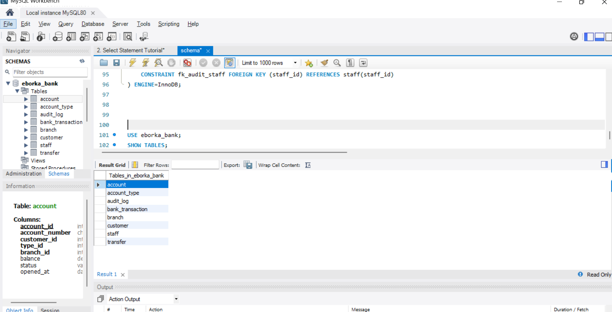
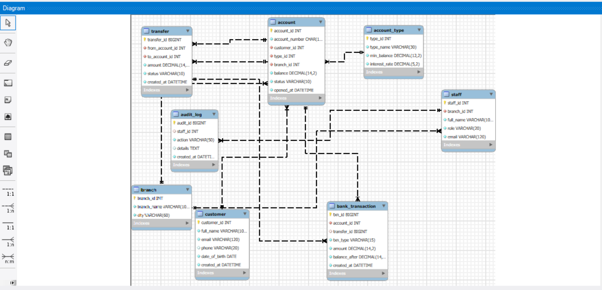
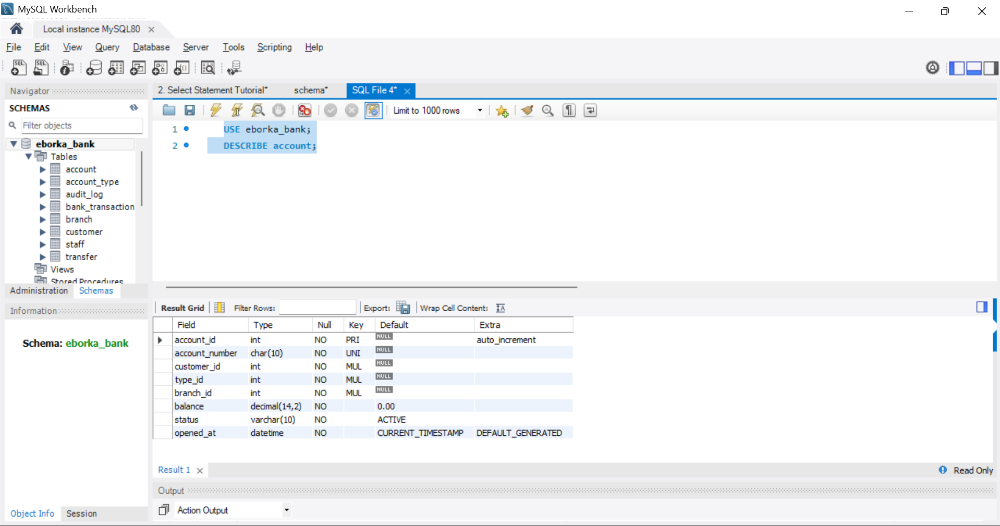
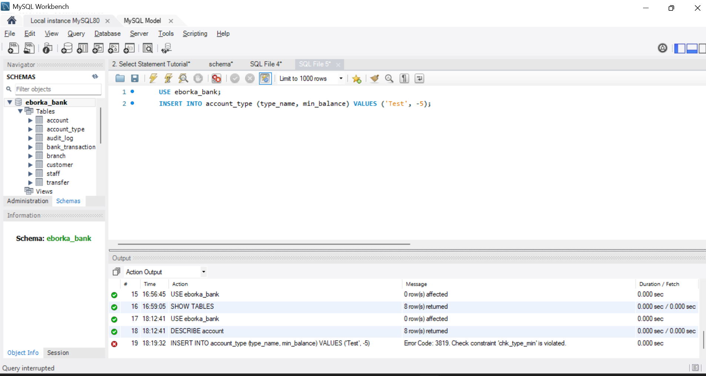

# Portfolio 1: Database Design and Modelling

**Student:** Eborka Marvellous  
**Student ID:** 301922558  
**Course:** MIT 8103 — Advanced Database Systems (2026/2027)  
**Case study:** Eborka Trust Bank (simulated retail bank)  
**DBMS:** MySQL 8.0.42, using MySQL Workbench  
**Database schema:** `eborka_bank`

## 1. Objective and banking context

Eborka Trust Bank is a simulated retail bank offering account services through branches and digital banking channels. Customers may open accounts and perform deposits, withdrawals and transfers, while authorised bank staff need access to account information and audit records. The database must keep related information organised and reject structurally invalid data.

This portfolio documents the **design and implementation of a relational database** for that scenario. It covers the selected organisation, eight-table schema, entity relationships, primary and foreign keys, integrity constraints, normalisation to third normal form (3NF), and practical evidence from MySQL Workbench.

| Requirement | Design choice |
|---|---|
| Database users | Customers, tellers, branch managers and auditors |
| Main data | Branches, staff, customers, account types, accounts, transfers, bank transactions and audit logs |
| Intended operations | Account opening, deposits, withdrawals, transfers, account statements, transaction review and auditing |
| Main implementation file | [`Eborka_Marvellous_301922558_schema.sql`](Eborka_Marvellous_301922558_schema.sql) |

The schema provides the **data structure** for these operations. Transaction-processing behaviour is developed and tested separately in Portfolio 3; defining tables does not, by itself, implement every banking workflow.

## 2. Relational schema: eight tables

The implementation in [`Eborka_Marvellous_301922558_schema.sql`](Eborka_Marvellous_301922558_schema.sql) creates eight InnoDB tables. Each table represents a particular part of the banking process instead of combining all information in one large table.

| Table | Purpose | Primary key |
|---|---|---|
| `branch` | Branch name and city | `branch_id` |
| `staff` | Employees, their assigned branches and roles | `staff_id` |
| `customer` | Customer identity and contact details | `customer_id` |
| `account_type` | Savings, Current or Fixed Deposit categories, minimum-balance setting and interest rate | `type_id` |
| `account` | Account number, owner, account type, branch, current balance and status | `account_id` |
| `transfer` | Sender, receiver, transfer amount and status | `transfer_id` |
| `bank_transaction` | Deposits, withdrawals and transfer entries, including the recorded post-transaction balance | `txn_id` |
| `audit_log` | Staff-related actions and descriptive audit details | `audit_id` |

### Verification: all eight tables were created

I executed `SHOW TABLES;` against `eborka_bank`. Screenshot 01 shows all eight tables in the result grid, confirming that the schema objects exist in MySQL.

**Screenshot 01 — `SHOW TABLES` listing the eight tables**



**Evidence:** [`Eborka_Marvellous_301922558_screenshot/Eborka_Marvellous_301922558_01_show_tables.png`](Eborka_Marvellous_301922558_screenshot/Eborka_Marvellous_301922558_01_show_tables.png) and [`Eborka_Marvellous_301922558_schema.sql`](Eborka_Marvellous_301922558_schema.sql).

## 3. ER diagram and relationships

The database uses foreign keys to connect related entities. The relationships model ordinary banking situations, including a customer owning multiple accounts and a transfer referring to two different accounts.

| Parent / related entities | Relationship represented |
|---|---|
| `branch` → `staff` | One branch can employ many staff members |
| `branch` → `account` | One branch can be assigned many accounts |
| `customer` → `account` | One customer can own multiple accounts |
| `account_type` → `account` | Many accounts can share an account type |
| `account` → `bank_transaction` | One account can have many transaction entries |
| `account` → `transfer` | An account can be the sending or receiving account in multiple transfers |
| `transfer` → `bank_transaction` | A transfer may be associated with transaction entries |
| `staff` → `audit_log` | One staff member can be associated with multiple audit records |

The `transfer` table has **two separate foreign keys** pointing to `account`: `from_account_id` identifies the sender and `to_account_id` identifies the receiver. The `bank_transaction.transfer_id` column is nullable, allowing entries such as standalone deposits and withdrawals without a linked transfer.

I used MySQL Workbench's reverse-engineering functionality to produce the EER diagram. The model is also available as a Workbench file, with a complementary Mermaid representation in Markdown.

**Screenshot 04 — EER diagram showing the eight tables and their links**



**Evidence:** [`Eborka_Marvellous_301922558_screenshot/Eborka_Marvellous_301922558_04_er_diagram.png`](Eborka_Marvellous_301922558_screenshot/Eborka_Marvellous_301922558_04_er_diagram.png), [`Eborka_Marvellous_301922558_er_diagram.md`](Eborka_Marvellous_301922558_er_diagram.md), and [`Eborka_Marvellous_301922558_bank_model.mwb`](Eborka_Marvellous_301922558_bank_model.mwb).

## 4. Keys and integrity constraints

### 4.1 Primary, unique and foreign keys

Each table has an automatically incremented primary key to uniquely identify its rows. For example, `account.account_id` is a primary key, and `account.account_number` has a `UNIQUE` constraint. Foreign keys such as `account.customer_id`, `account.type_id` and `account.branch_id` prevent an account from referencing an unrelated or nonexistent parent record.

I verified the table structure with:

```sql
USE eborka_bank;
DESCRIBE account;
```

In the Workbench result, `PRI` identifies `account_id` as the primary key, `UNI` marks the unique account number, and `MUL` appears for the indexed foreign-key columns. The output also displays required fields and defaults such as the account's initial balance of `0.00` and status `ACTIVE`.

**Screenshot 02 — `DESCRIBE account` showing fields, keys and defaults**



**Evidence:** [`Eborka_Marvellous_301922558_screenshot/Eborka_Marvellous_301922558_02_describe_account.png`](Eborka_Marvellous_301922558_screenshot/Eborka_Marvellous_301922558_02_describe_account.png).

### 4.2 Business and data-validity checks

I defined database-level constraints so invalid values can be rejected independently of application input screens.

| Rule in `Eborka_Marvellous_301922558_schema.sql` | What it protects |
|---|---|
| `chk_account_balance` | Prevents `account.balance` from being negative |
| `chk_type_min`, `chk_type_rate` | Prevent negative account-type minimum-balance and interest-rate settings |
| `chk_transfer_amount`, `chk_txn_amount` | Require positive transfer and transaction amounts |
| `chk_transfer_diff` | Rejects a transfer whose sender and receiver are the same account |
| `chk_staff_role` | Restricts staff roles to Teller, Manager or Auditor |
| `chk_account_status`, `chk_transfer_status`, `chk_txn_type` | Restrict fields to the permitted status or transaction types |
| `NOT NULL`, `DEFAULT`, `UNIQUE` and foreign keys | Require essential values, initialise selected fields and maintain identity/reference rules |

The `account_type.min_balance` field stores a configured minimum for that account type; the schema's check guarantees the configuration is **nonnegative**, but it does **not** independently enforce that each account balance stays above its type's configured minimum. That would require additional transaction/business logic.

### 4.3 Practical constraint test: rejected negative minimum balance

I attempted the following invalid insert:

```sql
INSERT INTO account_type (type_name, min_balance)
VALUES ('Test', -5);
```

MySQL rejected the statement with **Error Code 3819**, reporting that the `chk_type_min` check constraint was violated. This is evidence that the constraint was enforced rather than only documented in the schema.

**Screenshot 03 — negative minimum balance rejected by MySQL (Error 3819)**



**Evidence:** [`Eborka_Marvellous_301922558_screenshot/Eborka_Marvellous_301922558_03_constraint_error.png`](Eborka_Marvellous_301922558_screenshot/Eborka_Marvellous_301922558_03_constraint_error.png) and the `account_type` definition in [`Eborka_Marvellous_301922558_schema.sql`](Eborka_Marvellous_301922558_schema.sql).

## 5. Normalisation: from 1NF to 3NF

I separated customer, account, branch, account-type and transaction information to reduce duplication and the risk of inconsistent updates. The worked explanation is in [`Eborka_Marvellous_301922558_normalisation.md`](Eborka_Marvellous_301922558_normalisation.md).

| Stage | Design reasoning | Application to Eborka Trust Bank |
|---|---|---|
| **1NF** | Store atomic values and identify each row | Transactions occupy separate `bank_transaction` rows rather than repeated lists inside a customer record |
| **2NF** | Avoid partial dependencies on a composite key | Customer details are stored in `customer`; an account and its transactions reference the customer or account by key. The implemented tables use single-column primary keys, so they have no composite-primary-key partial dependencies |
| **3NF** | Remove non-key dependencies on other non-key attributes | `interest_rate` is stored in `account_type` instead of duplicated across accounts, and branch city is stored in `branch` instead of every linked account |

An illustrative unnormalised record might combine customer email, account number, account-type interest rate, branch city and individual transaction details. The implemented schema separates these subjects and connects them through foreign keys.

**Deliberate stored balance:** The `account` table holds the current `balance` for efficient retrieval. This is a deliberate persisted summary alongside the separate transaction records. Its correctness depends on controlled balance updates; Portfolio 3 shows transactional procedures and concurrency controls for that purpose. The synthetic performance dataset used in Portfolio 2 is not a reconciled banking ledger.

**Evidence:** [`Eborka_Marvellous_301922558_normalisation.md`](Eborka_Marvellous_301922558_normalisation.md), [`Eborka_Marvellous_301922558_schema.sql`](Eborka_Marvellous_301922558_schema.sql), and the EER diagram in screenshot 04.

## 6. Reproducing the database design

1. In MySQL Workbench, create a **new test database** using `CREATE DATABASE eborka_bank;` followed by `USE eborka_bank;`.
2. Execute [`Eborka_Marvellous_301922558_schema.sql`](Eborka_Marvellous_301922558_schema.sql) to create the eight InnoDB tables and their constraints.
3. Run `SHOW TABLES;` and `DESCRIBE account;` to inspect the resulting structure.
4. Run the invalid `account_type` insert from Section 4.3 in this disposable test environment and confirm that MySQL rejects it with Error 3819.
5. Open [`Eborka_Marvellous_301922558_bank_model.mwb`](Eborka_Marvellous_301922558_bank_model.mwb) in MySQL Workbench to inspect the saved model, or review [`Eborka_Marvellous_301922558_er_diagram.md`](Eborka_Marvellous_301922558_er_diagram.md) for the text-based ER representation.

> **Important:** `Eborka_Marvellous_301922558_schema.sql` contains `DROP TABLE IF EXISTS` statements and recreates the tables. Do **not** rerun it against your populated assignment database without a backup: it would remove existing test data and later portfolio results.

## 7. Evidence index

| File | Evidence provided |
|---|---|
| [`Eborka_Marvellous_301922558_schema.sql`](Eborka_Marvellous_301922558_schema.sql) | Complete relational DDL: eight tables, columns, keys and constraints |
| [`Eborka_Marvellous_301922558_screenshot/Eborka_Marvellous_301922558_01_show_tables.png`](Eborka_Marvellous_301922558_screenshot/Eborka_Marvellous_301922558_01_show_tables.png) | Successful `SHOW TABLES` output for all eight tables |
| [`Eborka_Marvellous_301922558_screenshot/Eborka_Marvellous_301922558_02_describe_account.png`](Eborka_Marvellous_301922558_screenshot/Eborka_Marvellous_301922558_02_describe_account.png) | `DESCRIBE account` showing primary/unique/indexed columns and defaults |
| [`Eborka_Marvellous_301922558_screenshot/Eborka_Marvellous_301922558_03_constraint_error.png`](Eborka_Marvellous_301922558_screenshot/Eborka_Marvellous_301922558_03_constraint_error.png) | Invalid account-type minimum rejected with Error 3819 (`chk_type_min`) |
| [`Eborka_Marvellous_301922558_screenshot/Eborka_Marvellous_301922558_04_er_diagram.png`](Eborka_Marvellous_301922558_screenshot/Eborka_Marvellous_301922558_04_er_diagram.png) | MySQL Workbench EER model showing table relationships |
| [`Eborka_Marvellous_301922558_bank_model.mwb`](Eborka_Marvellous_301922558_bank_model.mwb) | Editable MySQL Workbench model |
| [`Eborka_Marvellous_301922558_er_diagram.md`](Eborka_Marvellous_301922558_er_diagram.md) | Mermaid ER-diagram representation |
| [`Eborka_Marvellous_301922558_normalisation.md`](Eborka_Marvellous_301922558_normalisation.md) | Normalisation explanation with a starting unnormalised example |

## 8. Practical findings and limitations

The screenshots show that all eight tables were created, the `account` definition includes its expected keys and defaults, and the `chk_type_min` rule blocks a negative value. The ER model and DDL demonstrate how customers, accounts, staff, transfers and audit records relate.

This portfolio documents **schema-level design**, not a production banking application. The screenshot evidence directly tests one `CHECK` rule, rather than individually testing every foreign key, unique constraint and status rule. In addition, the schema permits `audit_log` entries but does not automatically generate them; auditing workflows would need further implementation.

## 9. Technical reflection

Separating banking information into related tables helped me connect the concepts of primary keys, foreign keys and normalisation to a practical use case. The `DESCRIBE account` output made the distinction between `PRI`, `UNI` and `MUL` more concrete. I also had to organise the Workbench diagram so the relationships could be read clearly. The negative-minimum-balance test was especially useful because it showed a database constraint actively stopping invalid data. I learned that a well-designed schema needs both clear relationships and rules that protect its integrity, while business workflows and concurrency controls still require further work.

## 10. AI-use declaration

**AI assistance:** Claude and ChatGPT helped explain relational modelling concepts and assisted with draft SQL examples and documentation. The final description is tied to the accompanying schema, Workbench model and captured constraint test, including the observed Error 3819. AI-generated suggestions are not presented as independent test results. Responsibility for the submitted design, citations and interpretation remains with the student.

**Reference:** [MySQL 8.0 Reference Manual — CREATE TABLE and integrity constraints](https://dev.mysql.com/doc/refman/8.0/en/create-table.html).
