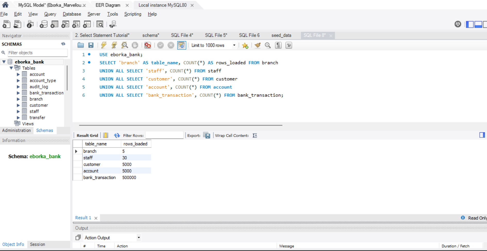
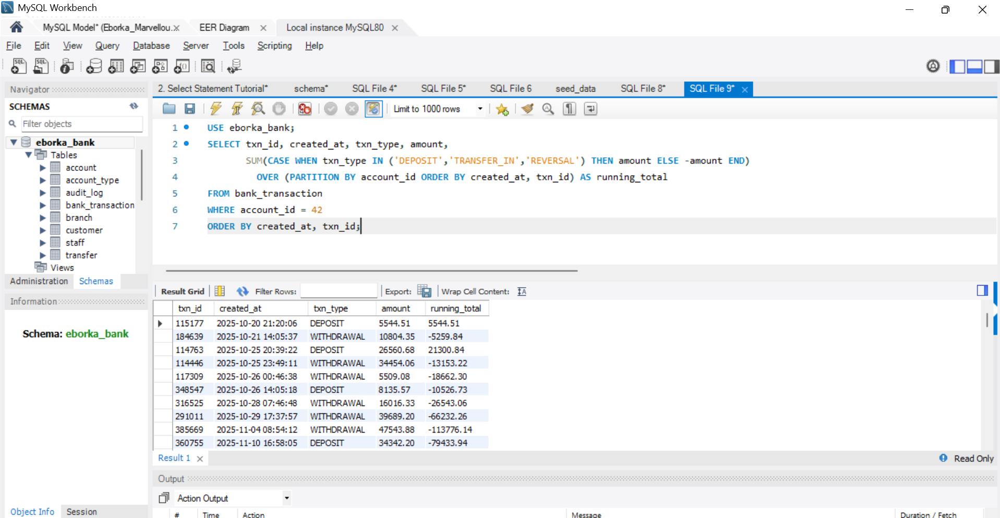
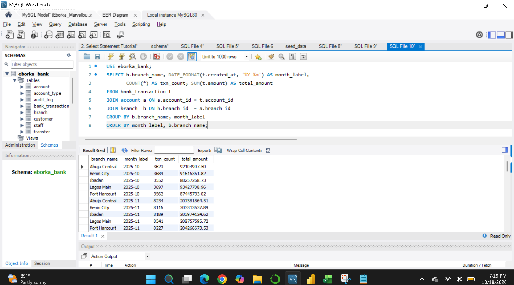
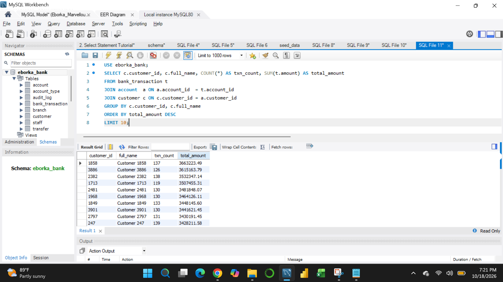
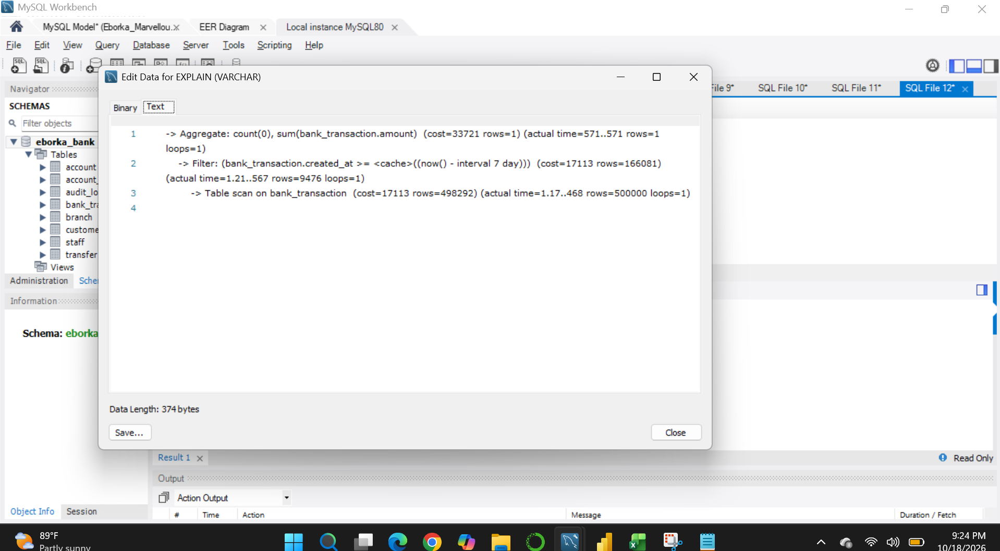
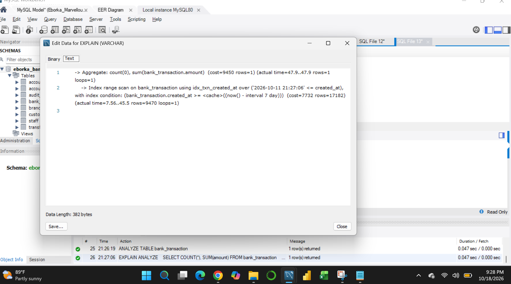
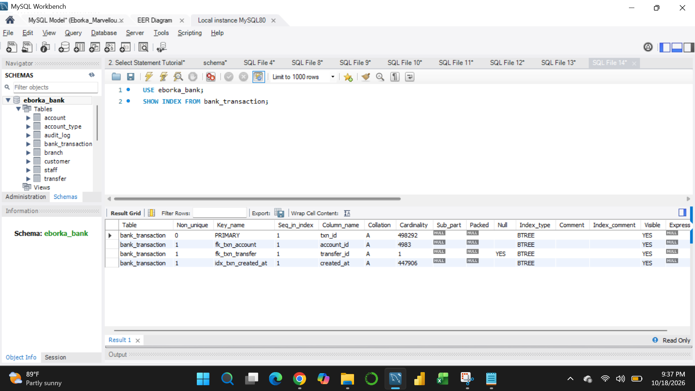
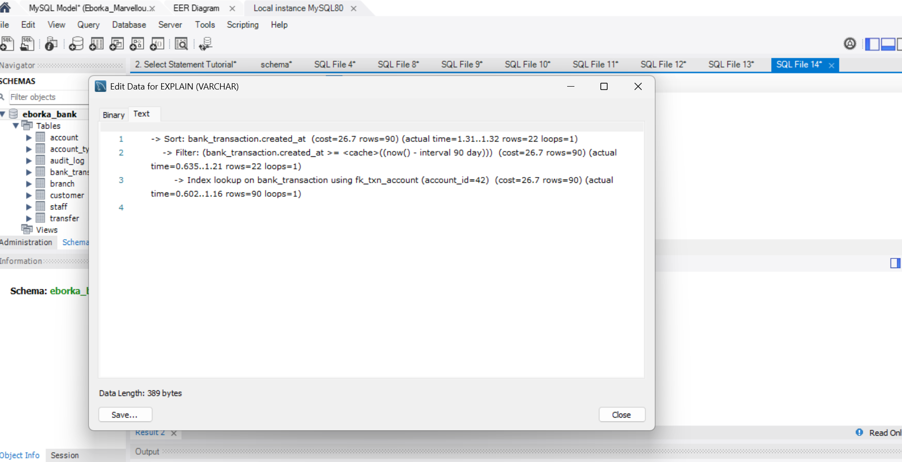
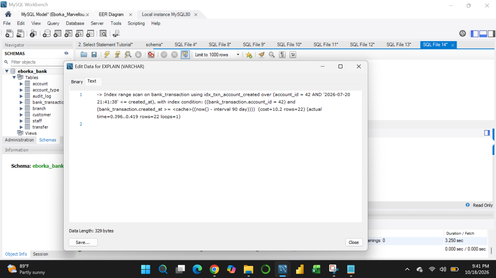

# Portfolio 2: Query Processing and Optimisation

**Student:** Eborka Marvellous  
**Student ID:** 301922558  
**Course:** MIT 8103 — Advanced Database Systems (2026/2027)  
**Case study:** Eborka Trust Bank (simulated retail bank)  
**DBMS:** MySQL 8.0.42, using MySQL Workbench  
**Database schema:** `eborka_bank`

## 1. Objective and banking context

As Eborka Trust Bank grows, its database must support both day-to-day account enquiries and reporting across many transactions. Queries that work quickly on a small dataset may become expensive when the transaction table contains hundreds of thousands of records.

This portfolio demonstrates **SQL querying and database optimisation** using the relational schema established in [Portfolio 1](../Eborka_Marvellous_301922558_Portfolio1_DatabaseDesign/Eborka_Marvellous_301922558_README.md). I generated synthetic test records, ran three banking-related queries, inspected their outputs, then used **`EXPLAIN ANALYZE`** to compare execution plans before and after adding suitable indexes.

**Main files:** [`Eborka_Marvellous_301922558_seed_data.sql`](Eborka_Marvellous_301922558_seed_data.sql) for generating test data and [`Eborka_Marvellous_301922558_queries.sql`](Eborka_Marvellous_301922558_queries.sql) for SQL queries, execution-plan tests and index statements.

## 2. Test-data preparation and verification

I loaded synthetic data into the existing `eborka_bank` schema so the query tests would operate on a substantial dataset. The script in [`Eborka_Marvellous_301922558_seed_data.sql`](Eborka_Marvellous_301922558_seed_data.sql) creates a temporary `seq` helper table of values from 1 to 500,000 using a recursive common table expression, uses these values to generate sample records, and drops the helper table after loading.

| Table | Rows shown in verification | Purpose in this portfolio |
|---|---:|---|
| `branch` | 5 | Branch-based summaries |
| `staff` | 30 | Sample branch employees |
| `customer` | 5,000 | Customer ranking |
| `account` | 5,000 | Link between customers, branches and transactions |
| `bank_transaction` | 500,000 | Main dataset for queries and indexing tests |

The script also inserts **three account types** (Savings, Current and Fixed Deposit). The five-table count screenshot does not include `account_type`, so its count is supported by the script rather than that screenshot.

Each generated account begins with a balance of **100,000.00**. The synthetic transactions have randomly selected account IDs, types (`DEPOSIT` or `WITHDRAWAL`), amounts and dates within the preceding 365 days. Generated customer names, emails and account numbers are test values rather than real customer data.

**Important data limitation:** The random transaction histories and `balance_after` values do **not** reconcile to the stored `account.balance`. This dataset is designed for testing query execution and indexing—not for validating a real bank ledger. Portfolio 3 uses controlled account balances for its transaction and concurrency demonstrations.

### Evidence: volume of data loaded

**Screenshot 05 — row counts confirming 500,000 transaction records**



**Evidence:** [`Eborka_Marvellous_301922558_screenshot/Eborka_Marvellous_301922558_05_row_counts.png`](Eborka_Marvellous_301922558_screenshot/Eborka_Marvellous_301922558_05_row_counts.png) and [`Eborka_Marvellous_301922558_seed_data.sql`](Eborka_Marvellous_301922558_seed_data.sql).

## 3. Practical SQL queries and outputs

The three banking queries are implemented in [`Eborka_Marvellous_301922558_queries.sql`](Eborka_Marvellous_301922558_queries.sql). The screenshots show their actual result grids rather than only the SQL statements.

### Query 1: account statement with a running total

**Banking use:** View transactions for account 42 chronologically and calculate the cumulative signed movement in the selected transaction history.

The query selects `txn_id`, `created_at`, `txn_type` and `amount`, and applies a **window function**:

```sql
SUM(CASE
      WHEN txn_type IN ('DEPOSIT','TRANSFER_IN','REVERSAL')
      THEN amount ELSE -amount
    END)
OVER (PARTITION BY account_id ORDER BY created_at, txn_id) AS running_total
```

The `PARTITION BY` and `ORDER BY` clauses keep the cumulative calculation within an account and in transaction order. Unlike a normal `GROUP BY`, the window function retains individual transaction rows in the result.

**Screenshot 06 — transactions for account 42 with `running_total`**



**Evidence:** [`Eborka_Marvellous_301922558_screenshot/Eborka_Marvellous_301922558_06_q1_statement.png`](Eborka_Marvellous_301922558_screenshot/Eborka_Marvellous_301922558_06_q1_statement.png) and Query 1 in [`Eborka_Marvellous_301922558_queries.sql`](Eborka_Marvellous_301922558_queries.sql).

**Interpretation:** Because the sample history was generated randomly and does not include a reconciled opening balance, this `running_total` is an **illustrative cumulative transaction total**, not a verified real-world account balance.

### Query 2: monthly transaction activity by branch

**Banking use:** Show how many transactions took place at each branch during each month, and the total recorded transaction amount.

The query joins `bank_transaction` to `account`, then to `branch`, groups the records using the branch name and a `YYYY-MM` month label, and calculates `COUNT(*)` and `SUM(amount)`. The result can support branch activity comparisons.

**Screenshot 07 — monthly transaction count and amount by branch**



**Evidence:** [`Eborka_Marvellous_301922558_screenshot/Eborka_Marvellous_301922558_07_q2_monthly_branch.png`](Eborka_Marvellous_301922558_screenshot/Eborka_Marvellous_301922558_07_q2_monthly_branch.png) and Query 2 in [`Eborka_Marvellous_301922558_queries.sql`](Eborka_Marvellous_301922558_queries.sql).

**Interpretation:** `SUM(amount)` measures the combined **value of recorded transactions**, not a net credit/debit cash-flow figure, because the query does not assign opposite signs to deposits and withdrawals.

### Query 3: top 10 customers by transaction value

**Banking use:** Identify customers associated with the largest total value of recorded transactions in the dataset.

The query joins `bank_transaction` to `account` and `customer`, groups by customer, computes `COUNT(*) AS txn_count` and `SUM(t.amount) AS total_amount`, then orders by **`total_amount DESC`** with `LIMIT 10`.

**Screenshot 08 — ten customers ranked by total transaction amount**



**Evidence:** [`Eborka_Marvellous_301922558_screenshot/Eborka_Marvellous_301922558_08_q3_top_customers.png`](Eborka_Marvellous_301922558_screenshot/Eborka_Marvellous_301922558_08_q3_top_customers.png) and Query 3 in [`Eborka_Marvellous_301922558_queries.sql`](Eborka_Marvellous_301922558_queries.sql).

**Interpretation:** The ranking is by **transaction value**, not transaction count. The result is specific to the synthetic records generated in this test run and should not be treated as a real customer ranking.

## 4. Method: evaluating query performance

To assess optimisation, I used `EXPLAIN ANALYZE`. Unlike a plan that only estimates execution, this statement **executes the query** and reports the plan steps together with measured row counts and execution timings.

The two tests address different access patterns:

| Test | Reporting question | Index introduced | Main optimisation |
|---|---|---|---|
| **A** | How many transactions and what total amount occurred in the past seven days? | `idx_txn_created_at` on `created_at` | Avoid scanning the entire transaction table |
| **B** | Which transactions belong to account 42 within the last 90 days, in date order? | `idx_txn_account_created` on `(account_id, created_at)` | Find and return the relevant rows without a separate sort |

All metrics below are **observations from the saved Workbench screenshots**, not guaranteed timing targets for future runs.

## 5. Test A: single-column index on transaction date

### 5.1 Query and baseline (before indexing)

```sql
EXPLAIN ANALYZE
SELECT COUNT(*), SUM(amount)
FROM bank_transaction
WHERE created_at >= NOW() - INTERVAL 7 DAY;
```

In screenshot 09, MySQL uses a **table scan** across the 500,000-row `bank_transaction` table, then filters records by date. The plan reports **9,476 qualifying rows** and an aggregate result time of approximately **571 ms**.

**Screenshot 09 — before index: full-table scan**



### 5.2 Index creation and retest

I added a single-column B-tree index on the date field and refreshed table statistics:

```sql
CREATE INDEX idx_txn_created_at
ON bank_transaction (created_at);

ANALYZE TABLE bank_transaction;
```

Screenshot 10 shows that MySQL switched to an **index range scan** using `idx_txn_created_at`. The plan reports **9,470 matching rows** and an aggregate result time of approximately **47.9 ms**. The small change in qualifying rows is consistent with the moving `NOW() - INTERVAL 7 DAY` cutoff between test runs.

**Screenshot 10 — after index: date-index range scan**



### 5.3 Before/after comparison

| Measure | Before index (09) | After index (10) |
|---|---:|---:|
| Access method | Full-table scan | Index range scan (`idx_txn_created_at`) |
| Rows scanned by main access step | 500,000 | 9,470 |
| Qualifying rows in result processing | 9,476 | 9,470 |
| Recorded aggregate execution time | ~571 ms | ~47.9 ms |
| Plan's estimated aggregate cost | 33,721 | 9,450 |

The recorded query time fell by approximately **91.6%**, or nearly **12×**. More importantly, the plan demonstrates why: MySQL could navigate directly to the recent-date range instead of scanning every transaction.

**What this proves:** An index aligned with a selective date predicate can materially improve queries for recent transactions. These are single-run measurements; their times will vary with caching, data distribution, database load and test timing.

**Evidence:** [`Eborka_Marvellous_301922558_screenshot/Eborka_Marvellous_301922558_09_before_index.png`](Eborka_Marvellous_301922558_screenshot/Eborka_Marvellous_301922558_09_before_index.png), [`Eborka_Marvellous_301922558_screenshot/Eborka_Marvellous_301922558_10_after_index.png`](Eborka_Marvellous_301922558_screenshot/Eborka_Marvellous_301922558_10_after_index.png), and Test A in [`Eborka_Marvellous_301922558_queries.sql`](Eborka_Marvellous_301922558_queries.sql).

## 6. Test B: composite index on account and date

### 6.1 Account statement query and existing indexes

The second experiment tests an account-specific date range returned in chronological order:

```sql
EXPLAIN ANALYZE
SELECT *
FROM bank_transaction
WHERE account_id = 42
  AND created_at >= NOW() - INTERVAL 90 DAY
ORDER BY created_at;
```

Before creating the composite index, the table already had indexes including the `PRIMARY` key, foreign-key indexes for `account_id` and `transfer_id`, and the date index added in Test A. The `account_id` foreign-key index could locate one account's entries but could not, on its own, provide the requested `(account_id, created_at)` date ordering and range in the same index.

**Screenshot 11 — `SHOW INDEX FROM bank_transaction` after Test A and before Test B**



### 6.2 Before the composite index

Screenshot 12 shows the execution sequence: MySQL uses the existing `fk_txn_account` index to look up **90 rows** for account 42, filters those to **22 rows** inside the 90-day window, and then sorts them by `created_at`.

The reported end-to-end result time is approximately **1.32 ms**, with estimated aggregate cost **26.7**.

**Screenshot 12 — lookup, filter and sort before the composite index**



### 6.3 Composite index and optimised plan

I then added an index with the **equality column first** and the date-range/sort column second:

```sql
CREATE INDEX idx_txn_account_created
ON bank_transaction (account_id, created_at);

ANALYZE TABLE bank_transaction;
```

Screenshot 13 shows a single **index range scan** using `idx_txn_account_created`, returning **22 rows** without the separate filter and sort plan nodes shown previously. The measured result time is approximately **0.42 ms**, with estimated cost **10.2**.

**Screenshot 13 — composite-index range scan without separate sort**



### 6.4 Before/after comparison

| Measure | Before composite index (12) | After composite index (13) |
|---|---:|---:|
| Access path | `fk_txn_account` lookup | `idx_txn_account_created` range scan |
| Rows visited at initial access step | 90 | 22 |
| Final matching rows | 22 | 22 |
| Plan operations | Index lookup → filter → sort | Index range scan |
| Recorded result time | ~1.32 ms | ~0.42 ms |
| Plan's estimated aggregate cost | 26.7 | 10.2 |

The measured result time improved by approximately **3.1×**, while the initial access step handled **about 76% fewer rows**. The most significant evidence is the **simpler execution plan**, because the composite index directly supports the combination of account equality, date range and date ordering.

**What this proves:** For a frequent account statement query, a composite index can be more useful than separate indexes on the two columns. The order `(account_id, created_at)` matters for this particular predicate and ordering pattern.

**Evidence:** [`Eborka_Marvellous_301922558_screenshot/Eborka_Marvellous_301922558_11_show_indexes.png`](Eborka_Marvellous_301922558_screenshot/Eborka_Marvellous_301922558_11_show_indexes.png), [`Eborka_Marvellous_301922558_screenshot/Eborka_Marvellous_301922558_12_before_composite.png`](Eborka_Marvellous_301922558_screenshot/Eborka_Marvellous_301922558_12_before_composite.png), [`Eborka_Marvellous_301922558_screenshot/Eborka_Marvellous_301922558_13_after_composite.png`](Eborka_Marvellous_301922558_screenshot/Eborka_Marvellous_301922558_13_after_composite.png), and Test B in [`Eborka_Marvellous_301922558_queries.sql`](Eborka_Marvellous_301922558_queries.sql).

## 7. Combined performance findings and trade-offs

| Test | Before | After | Result observed |
|---|---:|---:|---|
| A: recent seven-day activity | ~571 ms | ~47.9 ms | Date-range index replaced full-table scan; ~12× faster |
| B: account/date statement | ~1.32 ms | ~0.42 ms | Composite index removed separate filter/sort steps; ~3.1× faster |

The tests solve **two different** performance problems: one involves scanning a large table for recent records, while the other involves retrieving a small, ordered subset for one account.

Indexes are not free. They consume storage and must be maintained when rows are inserted, updated or deleted. I would therefore prioritise indexes that support frequent, important access patterns instead of indexing every field indiscriminately.

The benchmark figures are specific to this database and run. In particular, the time windows use `NOW()`, so even an otherwise identical rerun can return slightly different row counts.

## 8. Reproducing the practical work

1. Use a **separate, disposable test database**. Create the relational schema using [`../Eborka_Marvellous_301922558_Portfolio1_DatabaseDesign/Eborka_Marvellous_301922558_schema.sql`](../Eborka_Marvellous_301922558_Portfolio1_DatabaseDesign/Eborka_Marvellous_301922558_schema.sql). The Portfolio 1 script recreates tables, so do not run it against data you need to preserve.
2. Execute [`Eborka_Marvellous_301922558_seed_data.sql`](Eborka_Marvellous_301922558_seed_data.sql) **once** in that fresh schema. Confirm the row counts shown in screenshot 05; generating 500,000 rows may take time.
3. Run Queries 1–3 in [`Eborka_Marvellous_301922558_queries.sql`](Eborka_Marvellous_301922558_queries.sql) and inspect their output grids.
4. For Test A, run its first `EXPLAIN ANALYZE` **before** creating `idx_txn_created_at`. Create the index, run `ANALYZE TABLE`, and repeat the same query.
5. For Test B, inspect the indexes after Test A. Run its first account-statement `EXPLAIN ANALYZE` **before** creating `idx_txn_account_created`. Create the composite index, update statistics and rerun the query.
6. Compare the actual plan nodes, row counts and timings. If an index already exists, check the database state rather than rerunning its `CREATE INDEX` statement unchanged; a fresh baseline is needed to reproduce a valid before/after comparison.

> **Note:** Running `Eborka_Marvellous_301922558_seed_data.sql` again against an already seeded database can cause duplicate unique values and changes to the intended dataset. The saved timing screenshots are evidence from the original run, not a promise that every new environment will have the same timings.

## 9. Evidence index

| File | Evidence provided |
|---|---|
| [`Eborka_Marvellous_301922558_seed_data.sql`](Eborka_Marvellous_301922558_seed_data.sql) | Generated branches, staff, customers, accounts and 500,000 synthetic transaction records |
| [`Eborka_Marvellous_301922558_queries.sql`](Eborka_Marvellous_301922558_queries.sql) | Three banking queries, `EXPLAIN ANALYZE` commands and both index definitions |
| [`Eborka_Marvellous_301922558_screenshot/Eborka_Marvellous_301922558_05_row_counts.png`](Eborka_Marvellous_301922558_screenshot/Eborka_Marvellous_301922558_05_row_counts.png) | Row counts: 5 branches, 30 staff, 5,000 customers/accounts and 500,000 transactions |
| [`Eborka_Marvellous_301922558_screenshot/Eborka_Marvellous_301922558_06_q1_statement.png`](Eborka_Marvellous_301922558_screenshot/Eborka_Marvellous_301922558_06_q1_statement.png) | Account statement for account 42 with running-total window function |
| [`Eborka_Marvellous_301922558_screenshot/Eborka_Marvellous_301922558_07_q2_monthly_branch.png`](Eborka_Marvellous_301922558_screenshot/Eborka_Marvellous_301922558_07_q2_monthly_branch.png) | Monthly branch transaction counts and total amounts |
| [`Eborka_Marvellous_301922558_screenshot/Eborka_Marvellous_301922558_08_q3_top_customers.png`](Eborka_Marvellous_301922558_screenshot/Eborka_Marvellous_301922558_08_q3_top_customers.png) | Ten highest-value customers by summed transaction amount |
| [`Eborka_Marvellous_301922558_screenshot/Eborka_Marvellous_301922558_09_before_index.png`](Eborka_Marvellous_301922558_screenshot/Eborka_Marvellous_301922558_09_before_index.png) | Test A: full-table scan, ~571 ms |
| [`Eborka_Marvellous_301922558_screenshot/Eborka_Marvellous_301922558_10_after_index.png`](Eborka_Marvellous_301922558_screenshot/Eborka_Marvellous_301922558_10_after_index.png) | Test A: date-index range scan, ~47.9 ms |
| [`Eborka_Marvellous_301922558_screenshot/Eborka_Marvellous_301922558_11_show_indexes.png`](Eborka_Marvellous_301922558_screenshot/Eborka_Marvellous_301922558_11_show_indexes.png) | Existing indexes after Test A, before composite index |
| [`Eborka_Marvellous_301922558_screenshot/Eborka_Marvellous_301922558_12_before_composite.png`](Eborka_Marvellous_301922558_screenshot/Eborka_Marvellous_301922558_12_before_composite.png) | Test B: account-index lookup, date filter and sort, ~1.32 ms |
| [`Eborka_Marvellous_301922558_screenshot/Eborka_Marvellous_301922558_13_after_composite.png`](Eborka_Marvellous_301922558_screenshot/Eborka_Marvellous_301922558_13_after_composite.png) | Test B: composite-index range scan, ~0.42 ms |

## 10. Practical findings and limitations

The screenshot evidence confirms that the three SQL queries produced results against the generated dataset and that both index experiments changed MySQL's chosen access plan. The clearest optimisation evidence is the transition from a full-table scan to a date index range scan in Test A, and from lookup/filter/sort to one composite-index range scan in Test B.

The dataset is synthetic, with intentionally non-reconciled transaction histories and balances. The reported query times are individual observations—not repeated statistical benchmarks—and will depend on the operating environment. No production workload or large-scale concurrency test is claimed here. The results nevertheless demonstrate how query structure and index selection affect execution plans.

## 11. Technical reflection

This exercise showed me the difference between writing a query that returns the correct shape of results and designing it to retrieve those results efficiently. The account statement introduced a window function; the monthly and customer reports required joins, grouping and sorting. Comparing the `EXPLAIN ANALYZE` screenshots then helped me see why the first index avoided reading the whole transaction table and why the second index removed extra work for account-specific date queries. It also highlighted the need to interpret performance numbers carefully: a faster recorded time is useful evidence, but the change in the access plan explains the improvement more reliably than one measurement alone.

## 12. AI-use declaration

**AI assistance:** Claude and ChatGPT supported explanations of SQL reporting, index choices and `EXPLAIN ANALYZE`, and assisted with example code and document drafting. Performance figures in this README come from the saved MySQL Workbench screenshots, not from AI predictions. They represent the specific test runs described above and are not general speed guarantees. Responsibility for the submission and interpretation remains with the student.

**References:** [MySQL 8.0 — Optimization and Indexes](https://dev.mysql.com/doc/refman/8.0/en/optimization-indexes.html); [MySQL 8.0 — Understanding the Query Execution Plan](https://dev.mysql.com/doc/refman/8.0/en/execution-plan-information.html).
