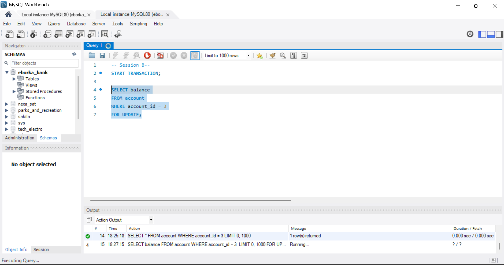
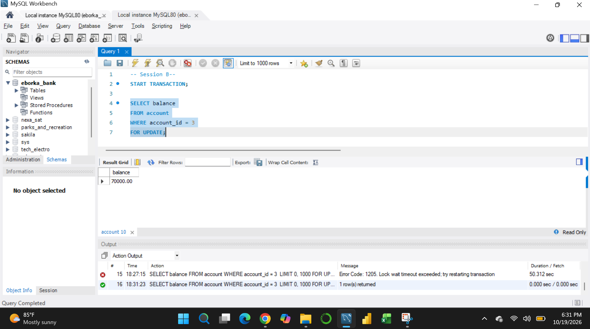
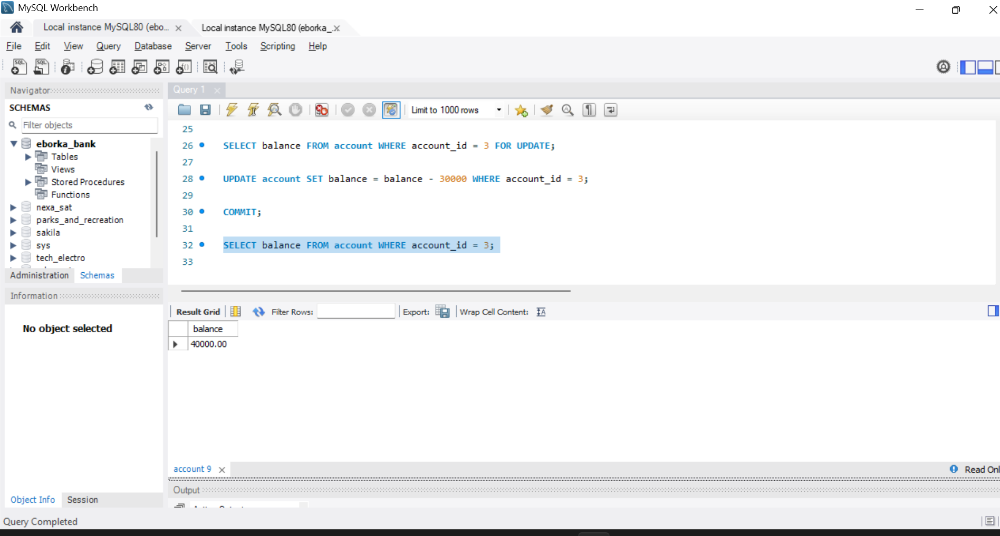

# Portfolio 3: Transactions and Concurrency

**Student:** Eborka Marvellous  
**Student ID:** 301922558  
**Course:** MIT 8103 — Advanced Database Systems (2026/2027)  
**Case study:** Eborka Trust Bank (simulated retail bank)  
**DBMS:** MySQL 8.0.42, using MySQL Workbench  
**Database schema:** `eborka_bank`

## 1. Objective and banking context

Eborka Trust Bank needs reliable database transactions because a funds transfer affects more than one record. Debiting the sender without crediting the receiver would make the banking records inconsistent. Similarly, two staff members working on the same account must not overwrite one another's changes.

This portfolio demonstrates **COMMIT**, **ROLLBACK**, a deliberately reproduced **lost update**, the use of **row-level locks with `SELECT ... FOR UPDATE`**, and the database's transaction isolation setting. The SQL files and numbered screenshots provide implementation evidence.

## 2. Transaction implementation: `transfer_funds`

I created a stored procedure named `transfer_funds` in [`Eborka_Marvellous_301922558_transactions.sql`](Eborka_Marvellous_301922558_transactions.sql). The procedure starts a transaction, acquires locks on the two account records using `SELECT ... FOR UPDATE`, validates the accounts and available balance, updates both balances, inserts a transfer record and two corresponding bank-transaction records, and commits the changes.

Both accounts are locked in ascending `account_id` order, reducing the risk of a deadlock when transfers involve the same accounts. The procedure also has a SQL-exception handler that executes `ROLLBACK` and passes the error back to the caller. The account table's non-negative-balance constraint provides an additional safeguard.

This design illustrates **atomicity**: the related debit, credit and transaction records either succeed together or are undone together.

**Evidence:** [`Eborka_Marvellous_301922558_screenshot/Eborka_Marvellous_301922558_14_create_procedure.png`](Eborka_Marvellous_301922558_screenshot/Eborka_Marvellous_301922558_14_create_procedure.png) — successful creation of the stored procedure.

## 3. Successful transfer and `COMMIT`

I tested the procedure with `CALL transfer_funds(1, 2, 5000, @tid);`.

| Account | Before transfer | After transfer | Change |
|---|---:|---:|---:|
| 1 (sender) | 100,000.00 | 95,000.00 | −5,000.00 |
| 2 (receiver) | 100,000.00 | 105,000.00 | +5,000.00 |

The total across both accounts remained unchanged. The transfer was committed, and the database recorded the outgoing and incoming entries (`TRANSFER_OUT` and `TRANSFER_IN`) in `bank_transaction`.

**Evidence:** [`Eborka_Marvellous_301922558_screenshot/Eborka_Marvellous_301922558_15_balance_before.png`](Eborka_Marvellous_301922558_screenshot/Eborka_Marvellous_301922558_15_balance_before.png), [`Eborka_Marvellous_301922558_screenshot/Eborka_Marvellous_301922558_16_balance_after_commit.png`](Eborka_Marvellous_301922558_screenshot/Eborka_Marvellous_301922558_16_balance_after_commit.png), [`Eborka_Marvellous_301922558_screenshot/Eborka_Marvellous_301922558_17_transfer_records.png`](Eborka_Marvellous_301922558_screenshot/Eborka_Marvellous_301922558_17_transfer_records.png).

## 4. Transaction failure and `ROLLBACK`

### 4.1 Automatic rollback on insufficient funds

I attempted to transfer **99,999,999.00** from account 1, an amount greater than its available balance. The stored procedure raised an **Insufficient funds** error. The error handler rolled back the transaction, leaving the balances at **95,000.00** and **105,000.00**; the failed attempt did not create an additional completed transfer record.

**Evidence:** [`Eborka_Marvellous_301922558_screenshot/Eborka_Marvellous_301922558_18_balance_before_fail.png`](Eborka_Marvellous_301922558_screenshot/Eborka_Marvellous_301922558_18_balance_before_fail.png), [`Eborka_Marvellous_301922558_screenshot/Eborka_Marvellous_301922558_19_failed_transfer_error.png`](Eborka_Marvellous_301922558_screenshot/Eborka_Marvellous_301922558_19_failed_transfer_error.png), [`Eborka_Marvellous_301922558_screenshot/Eborka_Marvellous_301922558_20_balance_after_rollback.png`](Eborka_Marvellous_301922558_screenshot/Eborka_Marvellous_301922558_20_balance_after_rollback.png).

### 4.2 Manual rollback

I also tested `START TRANSACTION` and `ROLLBACK` manually on account 1. The Workbench action log in screenshot 21 records **two updates increasing the balance by 1,000.00 each**, and the query result shows a temporary balance of **97,000.00**. After `ROLLBACK`, screenshot 22 shows that the saved balance remained **95,000.00**.

This demonstrates that changes visible inside an uncommitted transaction can be cancelled. The illustrative manual-rollback example in [`Eborka_Marvellous_301922558_transactions.sql`](Eborka_Marvellous_301922558_transactions.sql) contains a single 1,000.00 increase; the captured Workbench run contains two, but both demonstrate the same rollback behaviour.

**Evidence:** [`Eborka_Marvellous_301922558_screenshot/Eborka_Marvellous_301922558_21_inside_transaction.png`](Eborka_Marvellous_301922558_screenshot/Eborka_Marvellous_301922558_21_inside_transaction.png), [`Eborka_Marvellous_301922558_screenshot/Eborka_Marvellous_301922558_22_after_manual_rollback.png`](Eborka_Marvellous_301922558_screenshot/Eborka_Marvellous_301922558_22_after_manual_rollback.png).

## 5. Concurrency problem: lost update

I opened two separate MySQL Workbench connections to represent staff members operating on the same account. The screenshots show **connection ID 10 (Session A)** and **connection ID 12 (Session B)**.

Account 3 initially held **100,000.00**. In the lost-update demonstration, both sessions read this balance. Session A reduced the account to **70,000.00** using a value calculated from its earlier read and committed. Session B then also wrote **70,000.00** using its own earlier read of 100,000.00.

| Scenario | Expected result | Observed result |
|---|---:|---:|
| Two withdrawals of 30,000.00 from 100,000.00 | 40,000.00 | 70,000.00 |

The final **70,000.00** demonstrates a **lost update**: the second write overwrote the effect of the first withdrawal rather than applying a second reduction. In a real banking application, this would produce an incorrect balance.

**Evidence:** [`Eborka_Marvellous_301922558_screenshot/Eborka_Marvellous_301922558_23_two_sessions_A.png`](Eborka_Marvellous_301922558_screenshot/Eborka_Marvellous_301922558_23_two_sessions_A.png), [`Eborka_Marvellous_301922558_screenshot/Eborka_Marvellous_301922558_23_two_sessions_B.png`](Eborka_Marvellous_301922558_screenshot/Eborka_Marvellous_301922558_23_two_sessions_B.png), [`Eborka_Marvellous_301922558_screenshot/Eborka_Marvellous_301922558_24_lost_update_sessionA.png`](Eborka_Marvellous_301922558_screenshot/Eborka_Marvellous_301922558_24_lost_update_sessionA.png), [`Eborka_Marvellous_301922558_screenshot/Eborka_Marvellous_301922558_25_lost_update_sessionB.png`](Eborka_Marvellous_301922558_screenshot/Eborka_Marvellous_301922558_25_lost_update_sessionB.png), [`Eborka_Marvellous_301922558_screenshot/Eborka_Marvellous_301922558_26_lost_update_result.png`](Eborka_Marvellous_301922558_screenshot/Eborka_Marvellous_301922558_26_lost_update_result.png).

## 6. Concurrency control: row locking and a correct final balance

To address the lost-update problem, I used **`SELECT balance FROM account WHERE account_id = 3 FOR UPDATE`** within transactions. This is a locking read: when one transaction holds the row lock, another transaction requesting an incompatible lock on the same row must wait. The update also uses `balance = balance - 30000` rather than replacing the balance with an application-calculated constant.

The saved screenshots document the following sequence:

1. **Session B waits for the row lock — screenshot 27.** The Workbench Action Output shows the `SELECT ... FOR UPDATE` query as **Running**, with the connection waiting while the row was locked in another transaction. This is direct evidence that the locking attempt was blocked rather than immediately reading and modifying the account.
2. **Lock wait timeout and successful retry — screenshot 28.** The first locking-read attempt ended in MySQL **Error 1205: “Lock wait timeout exceeded; try restarting transaction”** after approximately **50.312 seconds**. This confirms that Session B could not obtain the lock within the timeout period. The same screenshot also shows a **later, successful execution** of the locking read (`1 row(s) returned`), with a balance of **70,000.00**. The successful result was a **retry**, not an automatic continuation of the timed-out statement.
3. **Correct final balance — screenshot 29.** Following the controlled updates and commits, the final query shows **40,000.00**, the expected result after applying both 30,000.00 withdrawals to an initial 100,000.00 balance.

The timeout in screenshot 28 is **not evidence that locking failed**. It demonstrates that the second session was prevented from acquiring the same row lock while contention persisted. The later successful query and final 40,000.00 balance show that access could subsequently proceed and that the two withdrawals were reflected without the lost-update outcome. However, these screenshots do not show the original blocked statement resuming automatically; that first attempt timed out.

### Main screenshots: blocked query, successful retry and final result

**Screenshot 27 — Session B waiting for the row lock**

**Screenshot 28 — first attempt timed out; later retry succeeded, returning 70,000.00**

**Screenshot 29 — corrected final balance of 40,000.00**

### Why this approach is safer

- **Row-level locking:** `SELECT ... FOR UPDATE` stops concurrent transactions from updating a locked account row at the same time.
- **Relative balance updates:** `SET balance = balance - 30000` acts on the current database value instead of writing a possibly stale value calculated earlier.
- **Consistent lock ordering:** The `transfer_funds` procedure locks account rows in a consistent order, helping avoid circular waiting between transfers involving the same two accounts.

The complete instructional sequence is recorded in [`Eborka_Marvellous_301922558_concurrency_demo.sql`](Eborka_Marvellous_301922558_concurrency_demo.sql). Its ideal sequence explains what happens if Session A releases the lock before Session B reaches its timeout; my captured run instead shows the timeout **followed by a successful retry**, as documented above.

## 7. Transaction isolation

Isolation determines how one transaction interacts with changes made by another. The principal SQL isolation levels are **READ UNCOMMITTED**, **READ COMMITTED**, **REPEATABLE READ** and **SERIALIZABLE**.

I ran `SELECT @@transaction_isolation;` and observed **REPEATABLE-READ**, MySQL InnoDB's normal default setting. Under REPEATABLE READ, ordinary consistent reads in a transaction use a stable snapshot, while locking reads such as `FOR UPDATE` follow different locking rules. The lost-update example deliberately wrote stale, precomputed values, so the default isolation level by itself did not prevent that application-level error.

**Evidence:** [`Eborka_Marvellous_301922558_screenshot/Eborka_Marvellous_301922558_30_isolation_level.png`](Eborka_Marvellous_301922558_screenshot/Eborka_Marvellous_301922558_30_isolation_level.png).

## 8. Practical findings and limitations

The successful and failed funds-transfer tests demonstrate transaction atomicity. The separate lost-update and locking tests demonstrate why concurrent account access requires correct transaction design. In particular, **screenshots 27 and 28 provide live evidence of lock contention**, including a timeout and later retry, and screenshot 29 shows the correct final balance.

The locking demonstration was not a seamless wait-then-resume: the original query timed out before the later successful execution. I did not capture a separate deadlock experiment or a comparison test across multiple isolation levels. These are documented limitations rather than assumed results.

For a real banking system, production code would additionally need careful handling of timeouts, transaction retries, input validation, and audit requirements.

## 9. Reproducing the work

1. Create the database with [`../Eborka_Marvellous_301922558_Portfolio1_DatabaseDesign/Eborka_Marvellous_301922558_schema.sql`](../Eborka_Marvellous_301922558_Portfolio1_DatabaseDesign/Eborka_Marvellous_301922558_schema.sql) and load the required sample records using [`../Eborka_Marvellous_301922558_Portfolio2_QueryOptimisation/Eborka_Marvellous_301922558_seed_data.sql`](../Eborka_Marvellous_301922558_Portfolio2_QueryOptimisation/Eborka_Marvellous_301922558_seed_data.sql), preferably in a disposable test database.
2. Use [`Eborka_Marvellous_301922558_transactions.sql`](Eborka_Marvellous_301922558_transactions.sql) to create `transfer_funds`, then execute the selected transfer, rollback and verification statements. The oversized transfer intentionally raises an error.
3. For the concurrency demonstrations, open **two separate MySQL Workbench connections** to `eborka_bank` and follow the labelled Session A/Session B instructions in [`Eborka_Marvellous_301922558_concurrency_demo.sql`](Eborka_Marvellous_301922558_concurrency_demo.sql).
4. Reset account 3 to 100,000.00 between independent demonstrations, as instructed in the concurrency script.
5. For the locking demonstration, commit or roll back Session A to release its lock. If Session B reaches Error 1205 first, end or restart the affected test transaction as appropriate and retry the locking read once the lock is available. Verify the final balance after both transactions complete.

> **Note:** The demo deliberately changes account balances. Use test data, and do not re-run the transfer calls against a database whose balances must remain unchanged.

## 10. Evidence index

| File | Evidence provided |
|---|---|
| [`Eborka_Marvellous_301922558_transactions.sql`](Eborka_Marvellous_301922558_transactions.sql) | Stored procedure, commit, failed transaction and rollback examples |
| [`Eborka_Marvellous_301922558_concurrency_demo.sql`](Eborka_Marvellous_301922558_concurrency_demo.sql) | Two-session concurrency demonstrations and isolation-level examples |
| [`Eborka_Marvellous_301922558_screenshot/Eborka_Marvellous_301922558_14_create_procedure.png`](Eborka_Marvellous_301922558_screenshot/Eborka_Marvellous_301922558_14_create_procedure.png) | Procedure creation |
| [`Eborka_Marvellous_301922558_screenshot/Eborka_Marvellous_301922558_15_balance_before.png`](Eborka_Marvellous_301922558_screenshot/Eborka_Marvellous_301922558_15_balance_before.png) | Account balances before successful transfer |
| [`Eborka_Marvellous_301922558_screenshot/Eborka_Marvellous_301922558_16_balance_after_commit.png`](Eborka_Marvellous_301922558_screenshot/Eborka_Marvellous_301922558_16_balance_after_commit.png) | Account balances after commit |
| [`Eborka_Marvellous_301922558_screenshot/Eborka_Marvellous_301922558_17_transfer_records.png`](Eborka_Marvellous_301922558_screenshot/Eborka_Marvellous_301922558_17_transfer_records.png) | Transfer and related bank-transaction records |
| [`Eborka_Marvellous_301922558_screenshot/Eborka_Marvellous_301922558_18_balance_before_fail.png`](Eborka_Marvellous_301922558_screenshot/Eborka_Marvellous_301922558_18_balance_before_fail.png) | Balances before failed transfer |
| [`Eborka_Marvellous_301922558_screenshot/Eborka_Marvellous_301922558_19_failed_transfer_error.png`](Eborka_Marvellous_301922558_screenshot/Eborka_Marvellous_301922558_19_failed_transfer_error.png) | Insufficient-funds error |
| [`Eborka_Marvellous_301922558_screenshot/Eborka_Marvellous_301922558_20_balance_after_rollback.png`](Eborka_Marvellous_301922558_screenshot/Eborka_Marvellous_301922558_20_balance_after_rollback.png) | Balances unchanged after procedure rollback |
| [`Eborka_Marvellous_301922558_screenshot/Eborka_Marvellous_301922558_21_inside_transaction.png`](Eborka_Marvellous_301922558_screenshot/Eborka_Marvellous_301922558_21_inside_transaction.png) | Temporary balance of 97,000.00 in manual transaction |
| [`Eborka_Marvellous_301922558_screenshot/Eborka_Marvellous_301922558_22_after_manual_rollback.png`](Eborka_Marvellous_301922558_screenshot/Eborka_Marvellous_301922558_22_after_manual_rollback.png) | Balance restored to 95,000.00 after rollback |
| [`Eborka_Marvellous_301922558_screenshot/Eborka_Marvellous_301922558_23_two_sessions_A.png`](Eborka_Marvellous_301922558_screenshot/Eborka_Marvellous_301922558_23_two_sessions_A.png) | Session A connection ID 10 |
| [`Eborka_Marvellous_301922558_screenshot/Eborka_Marvellous_301922558_23_two_sessions_B.png`](Eborka_Marvellous_301922558_screenshot/Eborka_Marvellous_301922558_23_two_sessions_B.png) | Session B connection ID 12 |
| [`Eborka_Marvellous_301922558_screenshot/Eborka_Marvellous_301922558_24_lost_update_sessionA.png`](Eborka_Marvellous_301922558_screenshot/Eborka_Marvellous_301922558_24_lost_update_sessionA.png) | Session A's lost-update steps |
| [`Eborka_Marvellous_301922558_screenshot/Eborka_Marvellous_301922558_25_lost_update_sessionB.png`](Eborka_Marvellous_301922558_screenshot/Eborka_Marvellous_301922558_25_lost_update_sessionB.png) | Session B's lost-update steps |
| [`Eborka_Marvellous_301922558_screenshot/Eborka_Marvellous_301922558_26_lost_update_result.png`](Eborka_Marvellous_301922558_screenshot/Eborka_Marvellous_301922558_26_lost_update_result.png) | Incorrect lost-update result: 70,000.00 |
| [`Eborka_Marvellous_301922558_screenshot/Eborka_Marvellous_301922558_27_blocked_sessionB.png`](Eborka_Marvellous_301922558_screenshot/Eborka_Marvellous_301922558_27_blocked_sessionB.png) | Session B's locking query shown as Running while waiting |
| [`Eborka_Marvellous_301922558_screenshot/Eborka_Marvellous_301922558_28_unblocked_sessionB.png`](Eborka_Marvellous_301922558_screenshot/Eborka_Marvellous_301922558_28_unblocked_sessionB.png) | Error 1205 timeout on first attempt; later successful retry returning 70,000.00 |
| [`Eborka_Marvellous_301922558_screenshot/Eborka_Marvellous_301922558_29_fix_result.png`](Eborka_Marvellous_301922558_screenshot/Eborka_Marvellous_301922558_29_fix_result.png) | Correct final account balance of 40,000.00 |
| [`Eborka_Marvellous_301922558_screenshot/Eborka_Marvellous_301922558_30_isolation_level.png`](Eborka_Marvellous_301922558_screenshot/Eborka_Marvellous_301922558_30_isolation_level.png) | `REPEATABLE-READ` isolation setting |

## 11. Technical reflection

This practical exercise helped me distinguish a transaction that completes atomically from a transaction that is also safe under concurrent access. I observed how two sessions could overwrite one another when they reused a previously read balance, and how a locking read prevented a competing session from proceeding immediately. The lock wait timeout was a useful lesson: transaction control requires not only locks but also timely commits, appropriate rollback/retry handling and verification of the final data. The balance results and Workbench output were used to check the claims made in this README.

## 12. AI-use declaration

**AI assistance:** Claude and ChatGPT supported transaction explanations, SQL demonstration examples, troubleshooting and documentation drafting. The outcome descriptions use the saved MySQL Workbench evidence; in particular, screenshot 28 records a lock wait timeout followed by a **separate retry**, rather than an uninterrupted query. The student remains responsible for explaining the sequence and verifying the SQL scripts and results.

**References:** [MySQL 8.0 — InnoDB Transaction Model](https://dev.mysql.com/doc/refman/8.0/en/innodb-transaction-model.html); [MySQL 8.0 — Locking Reads](https://dev.mysql.com/doc/refman/8.0/en/innodb-locking-reads.html).
