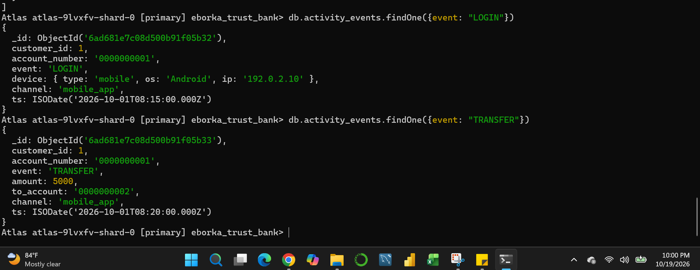
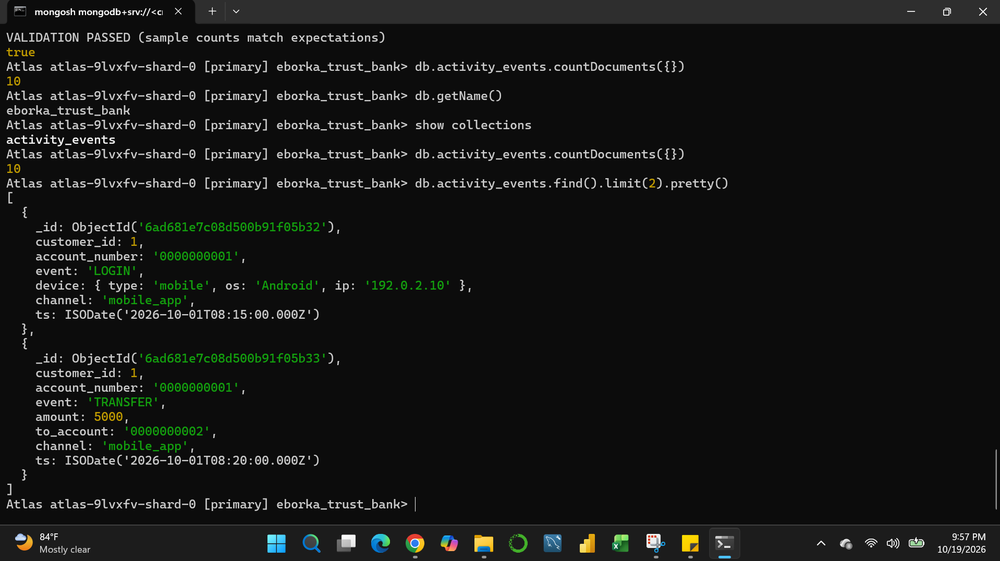
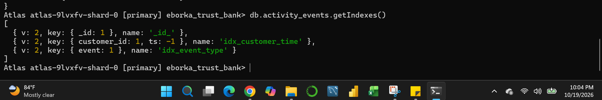
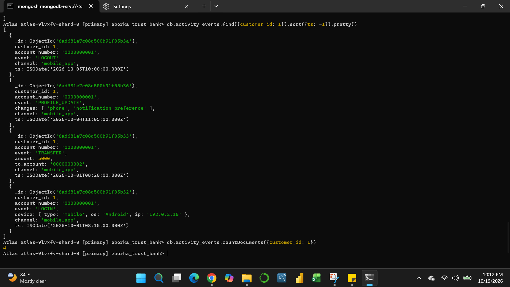
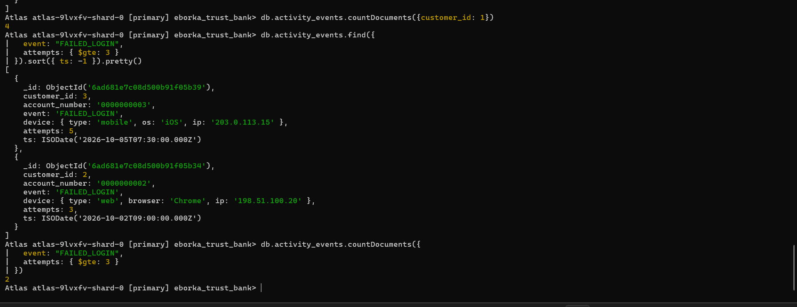
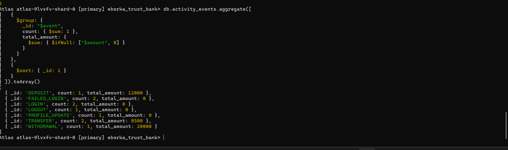
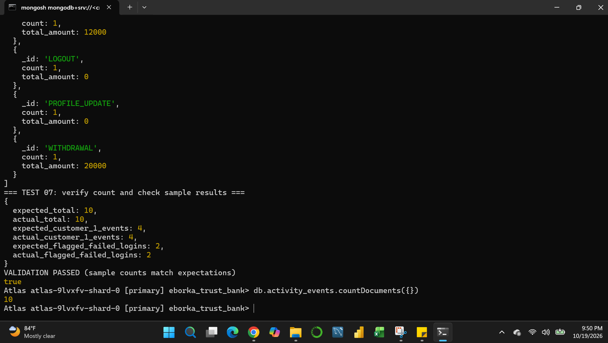

# Portfolio 4: NoSQL and Advanced Data Models

**Student:** Eborka Marvellous  
**Student ID:** 301922558  
**Course:** MIT 8103 — Advanced Database Systems (2026/2027)  
**Case study:** Eborka Trust Bank (simulated retail bank)  
**NoSQL DBMS:** MongoDB Atlas (MongoDB Server 8.0.34, free-tier cluster)  
**Client:** MongoDB Shell (`mongosh`) 2.13.0 on Windows  
**MongoDB database:** `eborka_trust_bank`  
**Collection:** `activity_events`

## 1. Objective and banking context

The relational **MySQL** database implemented for Eborka Trust Bank in Portfolios 1–3 stores structured customer, account, transfer and bank-transaction records. Portfolio 4 investigates a different workload: **digital banking activity and audit events**, including logins, transfers, withdrawals, profile updates, and failed login attempts.

I implemented a MongoDB **document data model** in MongoDB Atlas using synthetic banking events. The work demonstrates document insertion, flexible nested fields and arrays, index creation, filtering, sorting, aggregation, and verification using actual MongoDB Shell output. It uses the **same Eborka Trust Bank case study** as the previous portfolios, but it is a separate illustrative data store rather than a live integration with MySQL.

The implementation script is [`Eborka_Marvellous_301922558_mongodb_audit_events.js`](Eborka_Marvellous_301922558_mongodb_audit_events.js); a separate explanation of the modelling decision is available in [`Eborka_Marvellous_301922558_suitability.md`](Eborka_Marvellous_301922558_suitability.md).

## 2. Document model and design

I used one collection named `activity_events` to store several kinds of events. Shared properties allow consistent querying, while event-specific fields preserve the details relevant to each activity.

| Field | Purpose | Data type / example |
|---|---|---|
| `_id` | Unique MongoDB identifier | `ObjectId` |
| `customer_id` | References an illustrative banking customer | Integer (`1`, `2`, etc.) |
| `account_number` | Stores account identifier while preserving leading zeros | String (`"0000000001"`) |
| `event` | Categorises an activity | `LOGIN`, `TRANSFER`, `FAILED_LOGIN`, etc. |
| `ts` | Timestamp used for chronological retrieval | BSON Date |
| `device` | Additional information for a login | Embedded object with type, OS/browser and IP |
| `amount`, `to_account` | Details for monetary events where applicable | Number and string |
| `attempts` | Number of attempts in a failed-login event | Integer |
| `atm` | ATM identification and location for withdrawal events | Embedded object |
| `changes` | Fields affected by a profile update | Array of strings |
| `channel`, `branch_id` | Optional source/channel metadata | String or integer |

The schema is **flexible**, not entirely without rules: different document types can carry different optional fields. In this demonstration, no collection-level JSON Schema validator was configured. MongoDB does **not** automatically enforce a relational foreign key from `customer_id` or `account_number` to the separate MySQL database.

### Examples of differing document structures

A `LOGIN` document contains an embedded `device` object; a `TRANSFER` document instead carries `amount` and `to_account`. Both share key fields such as `customer_id`, `account_number`, `event` and `ts`. This avoids forcing all event types into an identical set of columns or many separate tables.

**Evidence — screenshot 32:** the results of `findOne({event: "LOGIN"})` and `findOne({event: "TRANSFER"})` show the distinct document shapes.



> The script's own `TEST 02` additionally prints a `WITHDRAWAL` document containing an embedded `atm` object. Screenshot 32 is a separate manual check comparing `LOGIN` and `TRANSFER`; both are valid examples of flexible document modelling.

## 3. MongoDB Atlas setup and data insertion

I created the **EborkaTrustBank** cluster on MongoDB Atlas and connected to its primary using MongoDB Shell. After selecting `eborka_trust_bank`, I created the `activity_events` collection and initially verified that it contained no documents. I then executed [`Eborka_Marvellous_301922558_mongodb_audit_events.js`](Eborka_Marvellous_301922558_mongodb_audit_events.js), which populated it with **10 fictional events**.

The script uses `db.getSiblingDB("eborka_trust_bank")`, resets the demo `activity_events` collection, inserts the samples using `insertMany()`, creates indexes, runs queries and aggregation, and checks expected counts.

**Manual verification commands:**

```javascript
use eborka_trust_bank
db.getName()
show collections
db.activity_events.countDocuments({})
db.activity_events.find().limit(2).pretty()
```

The saved output confirms the database and collection names, a count of **10** documents, and successful retrieval of a `LOGIN` record and a `TRANSFER` record.

**Evidence — screenshot 31:** database, collection, document count and two stored examples.



## 4. Index design and verification

Indexes were created in [`Eborka_Marvellous_301922558_mongodb_audit_events.js`](Eborka_Marvellous_301922558_mongodb_audit_events.js) to support common banking-audit access patterns:

```javascript
db.activity_events.createIndex(
  { customer_id: 1, ts: -1 },
  { name: "idx_customer_time" }
);
db.activity_events.createIndex(
  { event: 1 },
  { name: "idx_event_type" }
);
db.activity_events.getIndexes();
```

| Index | Key specification | Intended use |
|---|---|---|
| `_id_` | `{ _id: 1 }` | MongoDB's automatically created unique document index |
| `idx_customer_time` | `{ customer_id: 1, ts: -1 }` | Customer activity histories ordered newest first |
| `idx_event_type` | `{ event: 1 }` | Filtering audit records by event type |

**Evidence — screenshot 33:** `getIndexes()` confirms that these three indexes exist.



**Interpretation:** these indexes are intended to improve relevant access patterns as data grows. The screenshot verifies **index existence**, not that a particular query used an index or became faster. No indexed-versus-unindexed timing benchmark was conducted with this small dataset.

## 5. Customer activity retrieval and sorting

To review Customer 1's activity in reverse chronological order, I executed:

```javascript
db.activity_events.find({ customer_id: 1 })
  .sort({ ts: -1 }).pretty();

db.activity_events.countDocuments({ customer_id: 1 });
```

MongoDB returned **four** events in this order:

| Timestamp (UTC) | Activity |
|---|---|
| 2026-10-05 10:00 | `LOGOUT` |
| 2026-10-04 11:05 | `PROFILE_UPDATE` |
| 2026-10-01 08:20 | `TRANSFER` |
| 2026-10-01 08:15 | `LOGIN` |

The follow-up count returned `4`. This illustrates how an investigator or customer-service officer could inspect a customer's digital activity timeline, subject to appropriate access controls.

**Evidence — screenshot 34:** the sorted documents and the verified count.



## 6. Failed login detection: conditional query

For this practical I defined a **demonstration alert rule**: retrieve `FAILED_LOGIN` records where the recorded `attempts` value is **three or more**. I used MongoDB's `$gte` (greater-than-or-equal-to) comparison operator:

```javascript
db.activity_events.find({
  event: "FAILED_LOGIN",
  attempts: { $gte: 3 }
}).sort({ ts: -1 }).pretty();

db.activity_events.countDocuments({
  event: "FAILED_LOGIN",
  attempts: { $gte: 3 }
});
```

| Customer | Failed attempts | Result |
|---|---:|---|
| Customer 3 | 5 | Matched |
| Customer 2 | 3 | Matched |

The count returned **2 matching documents**. Each result also records device metadata and a timestamp. The query demonstrates filtering for security review; **a failed-login alert is not evidence that fraud has occurred**.

**Evidence — screenshot 35:** both documents returned by the conditional filter and the count of two.



## 7. Aggregation pipeline: event reporting

I ran an aggregation pipeline to count each event category and sum amounts where an `amount` field exists:

```javascript
db.activity_events.aggregate([
  {
    $group: {
      _id: "$event",
      count: { $sum: 1 },
      total_amount: {
        $sum: { $ifNull: ["$amount", 0] }
      }
    }
  },
  { $sort: { _id: 1 } }
]).toArray();
```

The `$group` stage groups events by category. `$sum: 1` counts events, while `$ifNull` treats missing/null monetary amounts as zero. The `$sort` stage in the **captured manual query** sorts alphabetically by event type. The script's automated `TEST 06` uses the same grouping calculation but sorts primarily by event count, so its display order can differ.

### Observed aggregation results

| Event | Count | Sum of recorded `amount` values |
|---|---:|---:|
| `DEPOSIT` | 1 | 12,000 |
| `FAILED_LOGIN` | 2 | 0 |
| `LOGIN` | 2 | 0 |
| `LOGOUT` | 1 | 0 |
| `PROFILE_UPDATE` | 1 | 0 |
| `TRANSFER` | 2 | 8,500 |
| `WITHDRAWAL` | 1 | 20,000 |
| **Total** | **10** | **40,500** |

The numeric amounts are **illustrative naira values** for the simulated Nigerian bank; the document design does not explicitly store a `currency` field. The **40,500** total is a sum of recorded deposit, transfer and withdrawal amounts, **not** a net balance, account ledger total or monetary reconciliation.

**Evidence — screenshot 36:** actual aggregation query and the seven category summaries.



## 8. Script validation and observed results

The script performs its own validation after insertion and querying, comparing expected counts with recorded counts. I also independently re-ran `countDocuments({})`.

| Validation | Expected | Observed |
|---|---:|---:|
| Total documents | 10 | 10 |
| Customer 1 events | 4 | 4 |
| `FAILED_LOGIN` documents with `attempts >= 3` | 2 | 2 |

The output included **`VALIDATION PASSED (sample counts match expectations)`**, followed by `true` for the successful `load()` command, and the independent collection count returned **10**.

**Evidence — screenshot 37:** validation fields, completion message and additional count query.



## 9. Suitability of MongoDB for this banking case study

A document database is suitable for **heterogeneous digital banking events** because login, ATM, transfer and profile-update events capture different details. Nested objects (`device`, `atm`) and arrays (`changes`) preserve these event-specific details naturally. MongoDB also supports indexed retrieval by customer/time, filtering security events, and aggregation for reporting.

The approach is complementary to, **not a replacement for**, the relational MySQL schema in Portfolios 1–3:

| Existing MySQL implementation | MongoDB demonstration |
|---|---|
| Structured customers, accounts, transfers and account balances | Flexible digital banking activity records |
| Keys, foreign keys, data constraints and funds-transfer transactions | Optional event-specific fields, embedded objects and arrays |
| Authoritative financial transaction records in the simulated workflow | Illustrative operational activity/audit records |

No real-time data pipeline, synchronisation process, or customer/account consistency check between MySQL and MongoDB was implemented. In a production bank, access control, retention policy, tamper resistance, secure audit logging, field validation and reliable event delivery would need additional design.

See [`Eborka_Marvellous_301922558_suitability.md`](Eborka_Marvellous_301922558_suitability.md) for further explanation.

## 10. Reproducing the implementation

1. Create or access a **test MongoDB Atlas cluster** with an authorised network address and a database user with the necessary permissions. Install MongoDB Shell (`mongosh`) if it is not available.
2. Connect with the Atlas-generated `mongosh` command. Do **not** commit or share passwords, private keys, or connection strings containing credentials.
3. In the connected shell, run the file (adapt the path to your computer):

   ```javascript
   load("C:/path/to/Eborka_Marvellous_301922558_Portfolio4_NoSQL/Eborka_Marvellous_301922558_mongodb_audit_events.js")
   ```

4. Confirm that `TEST 01`–`TEST 07` execute and that the final message says `VALIDATION PASSED`.
5. Execute the manual `findOne`, `getIndexes`, `find`, `countDocuments` and `aggregate` queries in sections 2–8 to reproduce the supporting outputs. Use the seven numbered screenshots as examples of the expected form of evidence.

## 11. Evidence and file index

| File | Evidence / purpose |
|---|---|
| [`Eborka_Marvellous_301922558_mongodb_audit_events.js`](Eborka_Marvellous_301922558_mongodb_audit_events.js) | Reproducible MongoDB sample insertion, indexes, queries, aggregation and validation |
| [`Eborka_Marvellous_301922558_suitability.md`](Eborka_Marvellous_301922558_suitability.md) | Explanation of document modelling and how it complements MySQL |
| [`Eborka_Marvellous_301922558_IMPLEMENTATION_GUIDE.md`](Eborka_Marvellous_301922558_IMPLEMENTATION_GUIDE.md) | Practical setup and test instructions |
| [`Eborka_Marvellous_301922558_screenshot/Eborka_Marvellous_301922558_31_mongodb_collection.png`](Eborka_Marvellous_301922558_screenshot/Eborka_Marvellous_301922558_31_mongodb_collection.png) | Database/collection, 10 documents and example retrieval |
| [`Eborka_Marvellous_301922558_screenshot/Eborka_Marvellous_301922558_32_mongodb_document_models.png`](Eborka_Marvellous_301922558_screenshot/Eborka_Marvellous_301922558_32_mongodb_document_models.png) | `LOGIN` and `TRANSFER` documents with different structures |
| [`Eborka_Marvellous_301922558_screenshot/Eborka_Marvellous_301922558_33_mongodb_indexes.png`](Eborka_Marvellous_301922558_screenshot/Eborka_Marvellous_301922558_33_mongodb_indexes.png) | Verification of `_id_`, `idx_customer_time`, and `idx_event_type` |
| [`Eborka_Marvellous_301922558_screenshot/Eborka_Marvellous_301922558_34_mongodb_customer_activity.png`](Eborka_Marvellous_301922558_screenshot/Eborka_Marvellous_301922558_34_mongodb_customer_activity.png) | Four customer events retrieved in descending time order |
| [`Eborka_Marvellous_301922558_screenshot/Eborka_Marvellous_301922558_35_mongodb_failed_logins.png`](Eborka_Marvellous_301922558_screenshot/Eborka_Marvellous_301922558_35_mongodb_failed_logins.png) | Two failed-login records meeting the threshold |
| [`Eborka_Marvellous_301922558_screenshot/Eborka_Marvellous_301922558_36_mongodb_aggregation.png`](Eborka_Marvellous_301922558_screenshot/Eborka_Marvellous_301922558_36_mongodb_aggregation.png) | Grouped event counts and amount sums |
| [`Eborka_Marvellous_301922558_screenshot/Eborka_Marvellous_301922558_37_mongodb_validation.png`](Eborka_Marvellous_301922558_screenshot/Eborka_Marvellous_301922558_37_mongodb_validation.png) | Script validation and independent document count |

## 12. Practical findings, limitations and technical reflection

This practical showed how a single MongoDB collection can accommodate different banking-event shapes and still support meaningful searching and reporting. I worked with MongoDB Atlas and `mongosh`, confirmed the successful insertion of 10 sample documents, checked the created indexes, retrieved four Customer 1 events, identified two failed-login records against a defined rule, and verified the aggregation output.

The key lesson is to **choose a data model based on the workload**: relational tables and transactions suit the simulated bank's financial records, while flexible documents suit its diverse activity records. A second lesson is to verify actual outputs and avoid claiming performance improvements merely because indexes have been created.

**Scope and limitations:** Only 10 fictional documents were tested. No large-scale performance benchmarking, MongoDB index `explain()` plan, data synchronisation with MySQL, production authentication/authorisation logic, or real-time fraud detection was implemented. The audit events are illustrative; this prototype is not a production banking security system.

## 13. Academic integrity, references and AI-use declaration

The case study and records are fictional, used solely for coursework. The commands, outputs and seven screenshots were executed or captured in my own MongoDB Atlas and MongoDB Shell environment; the results reported above reflect those observed outputs.

**AI-use declaration:** I used **Claude and ChatGPT** as learning and development aids to help with planning the NoSQL model, revising JavaScript examples, explaining MongoDB commands and improving technical documentation. I ran the implementation myself in MongoDB Atlas, checked the actual output and document counts, and reviewed the explanations against my screenshots and code. I remain responsible for understanding, verifying and explaining the submitted work.

**Reference resources:**

- [MongoDB Manual — Documents](https://www.mongodb.com/docs/manual/core/document/)
- [MongoDB Manual — Create Indexes](https://www.mongodb.com/docs/manual/core/indexes/create-index/)
- [MongoDB Manual — Aggregation Pipeline](https://www.mongodb.com/docs/manual/core/aggregation-pipeline/)
- [MongoDB Shell Documentation](https://www.mongodb.com/docs/mongodb-shell/)

