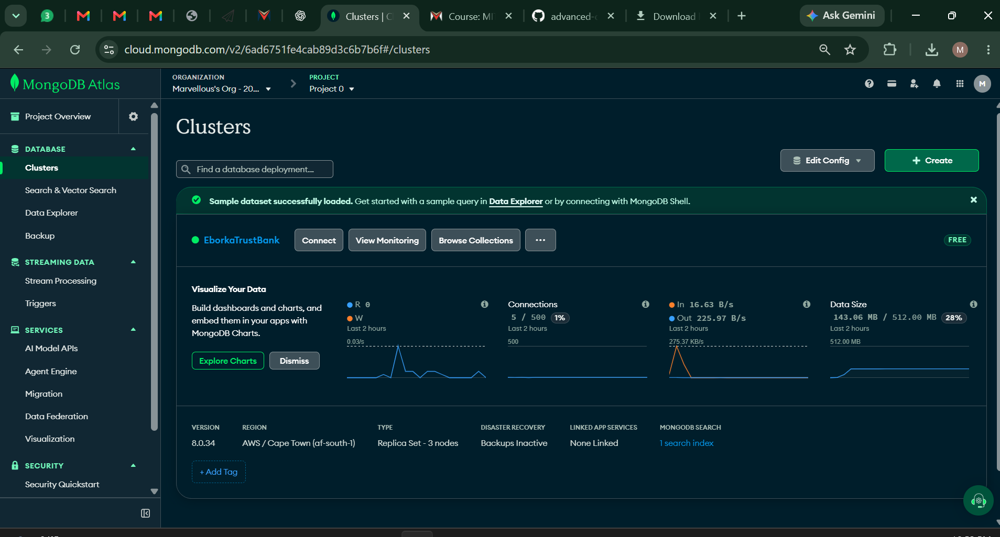
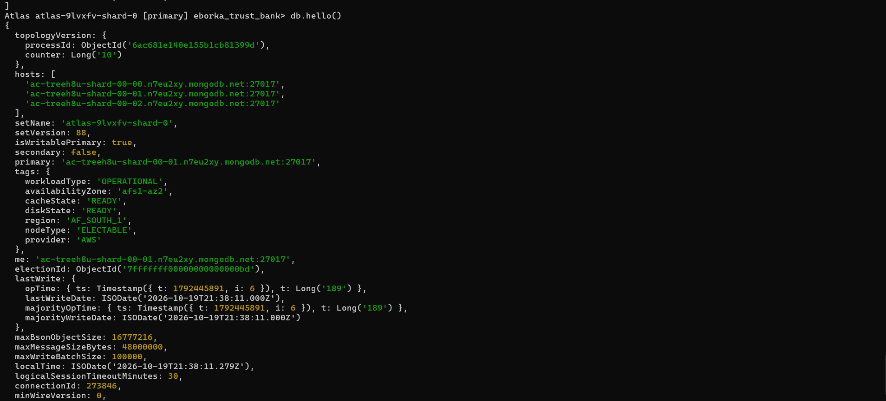
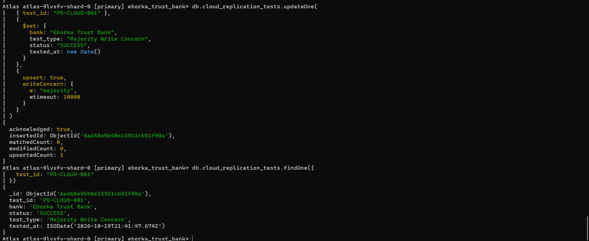
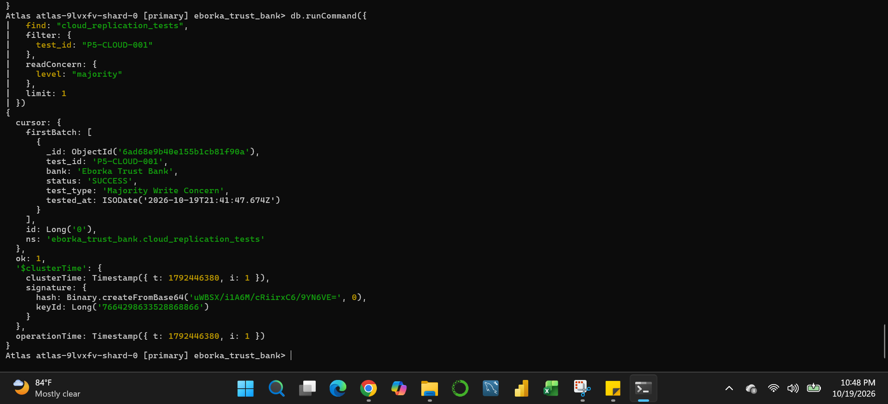
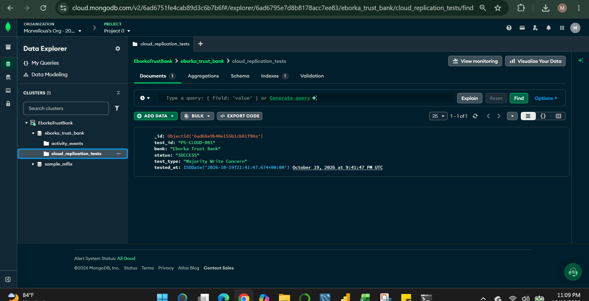
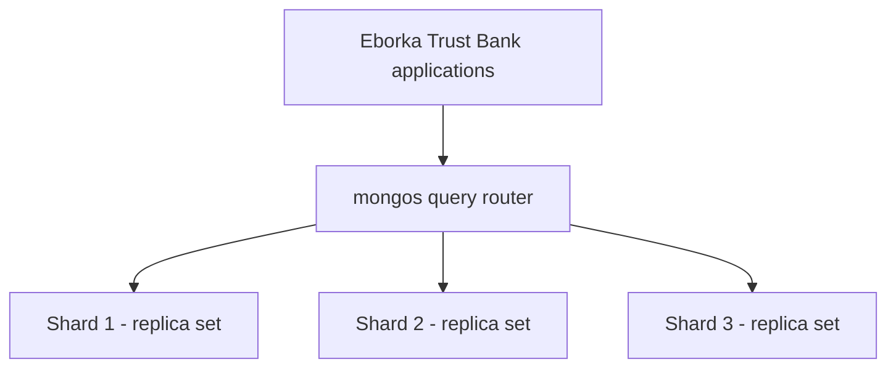

# Portfolio 5: Distributed and Cloud Database Exercise

**Student:** Eborka Marvellous  
**Course:** MIT 8103 — Advanced Database Systems (2026/2027)  
**Case study:** Eborka Trust Bank (simulated retail bank)  
**Database platform:** MongoDB Atlas (AWS; Free cluster; MongoDB 8.0.34)  
**Client:** MongoDB Shell (`mongosh`) on Windows  
**Database:** `eborka_trust_bank`  
**Evidence:** Five real screenshots, `41`–`45`

## 1. Objective and case-study continuity

Portfolio 5 investigates how **replication, cloud deployment, and read/write consistency** can support availability and durability in the fictional **Eborka Trust Bank**. In Portfolios 1–3, I used MySQL for the relational banking model, queries, and transactional controls. Portfolio 4 used MongoDB Atlas for flexible digital banking activity documents. For Portfolio 5, I continued with **that same Atlas database**, rather than creating an unrelated case study.

I examined the Atlas replica-set topology, performed an acknowledged test write requesting `w: "majority"`, retrieved the saved record using `readConcern: "majority"`, and verified the deployment and document in the Atlas web interface. I also developed a **proposed hashed-sharding design** for future growth. The sharding proposal was **not deployed** on the Free cluster.

The practical exercises used only **synthetic records**. This is an educational prototype, **not** a deployed production banking service and **not** live replication between the MySQL and MongoDB databases.

## 2. Cloud deployment and architecture

I used an existing managed MongoDB Atlas cluster named **`EborkaTrustBank`**. The deployment shown in Atlas had the following observed characteristics:

| Property | Observed configuration |
|---|---|
| Cluster | `EborkaTrustBank` |
| MongoDB database | `eborka_trust_bank` |
| Cloud provider | Amazon Web Services (AWS) |
| Region | Cape Town, South Africa (`af-south-1`) |
| Cluster tier | Free |
| MongoDB server | 8.0.34 |
| Deployment type | **Replica Set — 3 nodes** |
| Backup status shown | **Inactive** |
| Test collections | `activity_events`, `cloud_replication_tests` |

**Evidence — screenshot 44:** the Atlas Clusters dashboard confirms the cloud platform, region, version, free tier, replica-set node count, and backup status.



> The dashboard also displayed a `sample_mflix` database and storage usage. Those are not presented as Eborka Trust Bank's own transaction volume. Replication and backups serve different purposes: the cluster reports replication, but the dashboard shows that separate backups were inactive.

## 3. Replica-set topology: identifying the primary

In the authenticated MongoDB Shell connection, I ran:

```javascript
use eborka_trust_bank
db.hello()
```

The response included:

```javascript
setName: 'atlas-9lvxfv-shard-0',
// hosts: three replica-set members (00, 01, and 02)
isWritablePrimary: true,
secondary: false
// primary points to the member whose hostname ends in -01
```

| Field | Interpretation of the observed result |
|---|---|
| `setName` | Identifies the replica set reported by Atlas |
| `hosts` | Lists three replica-set member addresses |
| `primary` | Identifies member `01` as the primary *at the time of the test* |
| `isWritablePrimary: true` | Confirms the contacted node was writable at the time |
| `secondary: false` | The responding node was not acting as a secondary |

**Evidence — screenshot 41:** the original `db.hello()` result shows the three hosts and the primary's role.



### How replication relates to availability

A MongoDB replica set keeps replicated copies of database changes across members. The **primary** accepts normal writes; the other eligible data-bearing members replicate the primary's operations. Replica sets can support automatic election of a new primary when conditions permit. This improves **resilience**, but it does not guarantee uninterrupted service in every failure scenario.

**Scope of evidence:** screenshot 41 identifies the members and the current primary. I did **not** independently connect to each secondary, inspect its replication lag, trigger a node failure, or observe an election. The Atlas Free cluster does not permit primary-failover testing, so no successful failover is claimed.

## 4. Majority write concern — practical test

To investigate write acknowledgement, I created a separate demonstration record in the `cloud_replication_tests` collection. This kept the Portfolio 4 `activity_events` examples intact.

**Command executed:**

```javascript
db.cloud_replication_tests.updateOne(
  { test_id: "P5-CLOUD-001" },
  {
    $set: {
      bank: "Eborka Trust Bank",
      test_type: "Majority Write Concern",
      status: "SUCCESS",
      tested_at: new Date()
    }
  },
  {
    upsert: true,
    writeConcern: { w: "majority", wtimeout: 10000 }
  }
)
```

**Actual shell response:**

```javascript
{
  acknowledged: true,
  matchedCount: 0,
  modifiedCount: 0,
  upsertedCount: 1,
  upsertedId: ObjectId('...')
}
```

I then retrieved the document using `findOne({test_id: "P5-CLOUD-001"})`; the returned record contained the expected bank, test type, status and timestamp.

**Evidence — screenshot 42:** the `updateOne()` request with majority write concern, successful acknowledgement, insertion count, and subsequent record retrieval.



**Interpretation:** `w: "majority"` requests acknowledgement according to the calculated majority of eligible replica-set voting data-bearing members. The returned success response, with no write-concern error, supports that the requested write concern was satisfied. In a typical three-voting-data-member replica set, the majority is **two members**. This does **not** show that every node had applied the write, identify which secondary acknowledged it, or substitute for independent backups.

## 5. Majority read concern — practical test

I next read back **the same test record** using MongoDB's majority read concern:

```javascript
db.runCommand({
  find: "cloud_replication_tests",
  filter: { test_id: "P5-CLOUD-001" },
  readConcern: { level: "majority" },
  limit: 1
})
```

The response returned the expected document in `cursor.firstBatch`, with:

```javascript
ok: 1
```

The record included `test_id: 'P5-CLOUD-001'` and `status: 'SUCCESS'`.

**Evidence — screenshot 43:** the `find` command with `readConcern: {level: "majority"}`, the returned document, and `ok: 1`.



**Interpretation:** majority read concern limits the read to a majority-committed view of the data. Because the shell session was connected to the primary, this test **does not demonstrate reading from a secondary**. Combining majority reads and writes is useful for stronger consistency guarantees, but additional session/read-preference design is needed for some immediate cross-node read-after-write requirements, especially with MongoDB 8.0's asynchronous application of replicated operations.

## 6. Verification in Atlas Data Explorer

To independently check cloud persistence through a second interface, I opened **MongoDB Atlas → Data Explorer** and selected:

`EborkaTrustBank → eborka_trust_bank → cloud_replication_tests`

The sidebar showed the two project collections: `activity_events` (used in Portfolio 4) and `cloud_replication_tests` (used here). The Documents view displayed **one test document**, including `P5-CLOUD-001`, the `Eborka Trust Bank` label, and the `SUCCESS` field.

**Evidence — screenshot 45:** cloud-hosted collections and the test document displayed in the Atlas web interface.



This verifies that the demonstration record can be retrieved through the Atlas web interface. It does not independently verify which replica served the request or demonstrate a failover.

## 7. Availability, consistency, and durability analysis

| Concern | Application to Eborka Trust Bank | What the evidence shows |
|---|---|---|
| **Availability** | A replica set provides multiple members and the architectural ability to elect a replacement primary when sufficient members remain available. | Three-member configuration is visible, but **no failover was performed**. |
| **Write durability** | Majority acknowledgement reduces the risk of losing an acknowledged write in common failover conditions. | The write request returned `acknowledged: true`, `upsertedCount: 1`, and no write-concern error. |
| **Read consistency** | A majority read returns majority-committed data. | The expected test document was returned with `ok: 1`. |
| **Replication** | Replicated operations maintain copies across eligible members. | Topology is observed, but replication delay and per-secondary application were not measured. |
| **Backups / recovery** | Separate backups protect against deletion, corruption, and some incidents that replication can also propagate. | Atlas showed **Backups Inactive**; no restore or recovery exercise was performed. |
| **Security** | Real banking workloads require access restrictions, secure credentials, encryption, audit controls, and tested recovery processes. | Only an educational test record and permitted connection were exercised. |

For **authoritative balances and inter-account transfers**, the simulated bank should prioritise correctness, carefully controlled transactions and verified durability. **Audit and activity-event workloads** may have different latency and availability requirements. The small tests here do not establish a universal CAP classification or prove end-to-end consistency between the separate MySQL and MongoDB demonstrations.

## 8. Proposed future sharding design — not implemented

The observed Atlas Free cluster is a **three-member replica set, not a sharded deployment**. Atlas does not permit a Free cluster to be configured as a sharded cluster. Therefore, the design below is a **scaling proposal only**.



For the Portfolio 4 `activity_events` collection, a candidate shard key is:

```javascript
{ customer_id: "hashed" }
```

**Rationale:** hashing the customer ID can distribute records for many customers more evenly across shards while allowing the router to target an **equality query** for one customer. This complements the demonstrated Portfolio 4 query pattern `find({customer_id: 1}).sort({ts: -1})`.

**Trade-offs to investigate before production:**

- Queries filtering only by a time range, without customer ID, may need to reach several shards.
- A single very active customer may cause concentration of writes for that customer, despite hashed distribution across the full population.
- Customer-scoped indexing, global investigations, retention and compliance reporting require careful design.
- Sharded architectures introduce additional operational complexity and may increase costs; cross-shard operations require appropriate consistency and transaction choices.
- The bank would need to evaluate candidate keys using realistic volumes, query patterns and operational requirements.

No sharding commands were executed, and there is **no claim that the present cluster contains three shards**. Its three listed nodes are **replica-set members**, not shards.

## 9. Reproduction instructions and supporting files

The following commands reproduce the **individual manual exercises** in a connected `mongosh` session. The companion [`Eborka_Marvellous_301922558_atlas_replication_checks.js`](Eborka_Marvellous_301922558_atlas_replication_checks.js) gathers the topology, writes a synthetic test record, and reads it with majority concern. That companion file was assembled to make the workflow reproducible; **the screenshots document the commands I executed interactively**, not a recorded execution of the companion script itself.

```javascript
use eborka_trust_bank

db.hello()

// Run the majority upsert in Section 4.
// Run the majority read command in Section 5.

db.cloud_replication_tests.findOne({ test_id: "P5-CLOUD-001" })
```

To run the companion script from a connected shell, adjust the path and enter:

```javascript
load("C:/path/to/Eborka_Marvellous_301922558_Portfolio5_DistributedCloud/Eborka_Marvellous_301922558_atlas_replication_checks.js")
```

**Safety notes:** use a test environment; never upload Atlas passwords or connection strings containing credentials to GitHub. The script does **not** drop any collections, but its `upsert` updates the demo record's timestamp if rerun. Do not use production data for this exercise. The old repository also contained an **unexecuted MySQL/Docker replication starter**; this submitted portfolio documents the actual MongoDB Atlas work instead.

## 10. Evidence and file index

| File | Purpose |
|---|---|
| [`Eborka_Marvellous_301922558_screenshot/Eborka_Marvellous_301922558_41_mongodb_replica_topology.png`](Eborka_Marvellous_301922558_screenshot/Eborka_Marvellous_301922558_41_mongodb_replica_topology.png) | `db.hello()`: three listed hosts, replica-set name, primary status |
| [`Eborka_Marvellous_301922558_screenshot/Eborka_Marvellous_301922558_42_mongodb_majority_write.png`](Eborka_Marvellous_301922558_screenshot/Eborka_Marvellous_301922558_42_mongodb_majority_write.png) | `updateOne()` with majority write concern, acknowledgement and `findOne` verification |
| [`Eborka_Marvellous_301922558_screenshot/Eborka_Marvellous_301922558_43_mongodb_majority_read.png`](Eborka_Marvellous_301922558_screenshot/Eborka_Marvellous_301922558_43_mongodb_majority_read.png) | Majority read concern returns the test record (`ok: 1`) |
| [`Eborka_Marvellous_301922558_screenshot/Eborka_Marvellous_301922558_44_atlas_cloud_deployment.png`](Eborka_Marvellous_301922558_screenshot/Eborka_Marvellous_301922558_44_atlas_cloud_deployment.png) | Atlas deployment on AWS Cape Town; replica set, version, backups inactive |
| [`Eborka_Marvellous_301922558_screenshot/Eborka_Marvellous_301922558_45_atlas_cloud_collections.png`](Eborka_Marvellous_301922558_screenshot/Eborka_Marvellous_301922558_45_atlas_cloud_collections.png) | Data Explorer showing `activity_events`, `cloud_replication_tests` and test document |
| [`Eborka_Marvellous_301922558_atlas_replication_checks.js`](Eborka_Marvellous_301922558_atlas_replication_checks.js) | Companion reproducibility script; not an additional claimed screenshot test |
| [`Eborka_Marvellous_301922558_IMPLEMENTATION_GUIDE.md`](Eborka_Marvellous_301922558_IMPLEMENTATION_GUIDE.md) | Step-by-step setup, manual commands, and evidence checklist |
| [`Eborka_Marvellous_301922558_sharding_design.md`](Eborka_Marvellous_301922558_sharding_design.md) | Detailed conceptual sharding plan and limitations |

## 11. Limitations and individual technical reflection

The most useful practical distinction in this portfolio was learning that **replica-set membership, majority write acknowledgement, and majority reads are different pieces of evidence**. The `db.hello()` result showed a primary and three named hosts, but did not independently verify every secondary. The successful write acknowledged the majority concern, but did not mean each member had fully applied the record. The successful read showed a majority-committed document, not a secondary read.

I also observed that the managed Atlas deployment simplifies obtaining a working cloud database, but **Backups Inactive** remains a meaningful limitation. Another important distinction was recognising that **three replica-set members are not three shards**. Consequently I documented an appropriately labelled sharding proposal instead of claiming a sharded deployment or a failover test that the Free tier does not support.

All test documents in this portfolio were synthetic. There was no benchmark of throughput/latency, no primary interruption, no rollback/failover recovery measurement, no independent secondary-read test, no production backup test, and no live replication between the MySQL and MongoDB components of the course case study.

## 12. AI-use declaration

**AI assistance:** OpenAI ChatGPT helped explain Atlas setup, formulate example MongoDB commands and a reproducibility script, interpret returned outputs and structure this Markdown report. The majority write/read outcomes and topology observations reported here are supported by screenshots 41–45 from the connected Atlas environment. The companion script is supplied for reference and is not represented as a separately executed test. Responsibility for accuracy and interpretation remains with the student.

## 13. References

1. MongoDB, [Atlas Free Cluster Limits](https://www.mongodb.com/docs/atlas/reference/free-shared-limitations/) — replica-set configuration, sharding and failover-test restrictions.
2. MongoDB, [Write Concern](https://www.mongodb.com/docs/manual/reference/write-concern/) — `w: "majority"` and acknowledgement semantics.
3. MongoDB, [Read Concern](https://www.mongodb.com/docs/manual/reference/read-concern/) — majority-committed reads.
4. MongoDB, [Hashed Sharding](https://www.mongodb.com/docs/manual/core/hashed-sharding/) — hashed shard-key benefits and trade-offs.
5. MongoDB, [Replica Sets](https://www.mongodb.com/docs/manual/replication/) — replication architecture and elections.

---

**Summary:** the evidence demonstrates an AWS-hosted, three-node MongoDB Atlas replica set; a successful majority-acknowledged sample write and majority-committed read; and the stored document visible in Atlas Data Explorer. Sharding and failover are **design discussion only**, not executed results.
