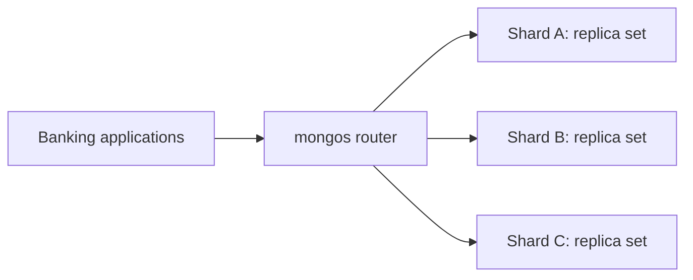

# Proposed Sharding Design — Eborka Trust Bank

> **Design-only exercise.** No sharded cluster was provisioned or tested. The Atlas Free deployment shown in Portfolio 5 is a **three-member replica set**, not three shards.

## Motivation

If Eborka Trust Bank's `activity_events` dataset grows from ten sample events to a large digital banking event stream, a single replica set could face pressure from storage, write throughput and large-scale audit analytics. Sharding is one possible scaling tool, subject to a real workload assessment and managed-cluster costs.

## Proposed logical design



A sharded MongoDB deployment also requires cluster metadata/configuration services managed by the platform. Each proposed shard here is itself a replica set; *replication* and *sharding* solve different problems.

## Candidate shard key

For the `activity_events` collection, a candidate is:

```javascript
{ customer_id: "hashed" }
```

**Reasons:** the dataset's customer identifier is present on each sample event; many customer IDs may distribute well through hashing; equality filters such as `{customer_id: 1}` can target a shard. The existing `{customer_id:1, ts:-1}` compound index is useful for customer timelines but does **not** by itself create a shard key or a sharded deployment.

## Trade-offs

| Workload | Potential effect |
|---|---|
| Customer-specific activity lookup | Equality on the shard key can permit targeted routing. |
| Global audit over a date range | Without shard-key equality, requests may involve multiple shards. |
| Many events from one customer | A heavily active single customer may concentrate traffic. |
| Cross-customer investigation | Can require more coordination and distributed aggregation. |
| Data retention and compliance | Needs consistent retention rules, data residency analysis, secure access and tested recovery. |
| Account balances and money transfers | Still require careful transactional design; this portfolio does not propose that the audit-event store is the authoritative bank ledger. |

## Rollout criteria for a hypothetical future project

1. Measure actual customer distribution, query shapes and data volume.
2. Evaluate multiple candidate keys, including a compound key if workloads justify it.
3. Estimate cluster cost, shard-balance behavior, index requirements and operational complexity.
4. Test targeted queries, global investigations, availability, and security in a **separate eligible non-production** environment.
5. Maintain appropriate backup and recovery processes.

## Limitations

The existing **Free Atlas cluster cannot be deployed as a sharded cluster**, so this is a documented design comparison. No `sh.shardCollection()` command was run, and no distributed performance benefit has been measured.

### References

- MongoDB [Hashed Sharding](https://www.mongodb.com/docs/manual/core/hashed-sharding/)
- MongoDB [Atlas Free Cluster Limits](https://www.mongodb.com/docs/atlas/reference/free-shared-limitations/)
